# Efficient Mixture-of-LoRA Experts in Needle — Comprehensive Results Report (Phases 0–4)

Date: 2026-11-08. Branch `main`. All experiments were run on CPU with the NumPy
backend of the 10-714 Needle framework; no GPU result exists anywhere in this
project and none is implied. Every number below is copied from a committed
phase report or result artifact, which is cited inline.

## Contents

1. [Research question and summary of findings](#1-research-question-and-summary-of-findings)
2. [Framework and implementation](#2-framework-and-implementation)
3. [Phase 1 — native LoRA baseline](#3-phase-1--native-lora-baseline)
4. [Phase 2 — dense Mixture-of-LoRA and the parameter-matched comparison](#4-phase-2--dense-mixture-of-lora-and-the-parameter-matched-comparison)
5. [Phase 3 — sparse top-k routing: correctness, quality, cost](#5-phase-3--sparse-top-k-routing-correctness-quality-cost)
6. [Phase 4A — 30-seed robustness and the balance-loss ablation](#6-phase-4a--30-seed-robustness-and-the-balance-loss-ablation)
7. [Phase 4B — implicit regime discovery under controlled overlap](#7-phase-4b--implicit-regime-discovery-under-controlled-overlap)
8. [Phase 4C — adapters inside a Needle transformer](#8-phase-4c--adapters-inside-a-needle-transformer)
9. [Cross-phase synthesis: when sparse routing helps, when it hurts](#9-cross-phase-synthesis-when-sparse-routing-helps-when-it-hurts)
10. [Supported conclusions, hypotheses, and limitations](#10-supported-conclusions-hypotheses-and-limitations)
11. [Reproducibility](#11-reproducibility)

---

## 1. Research question and summary of findings

**Question.** Can sparse Mixture-of-LoRA experts improve the predictive
performance, memory efficiency, and computational efficiency of
parameter-efficient fine-tuning compared with conventional single-adapter LoRA
and dense Mixture-of-LoRA, and under what conditions does sparse routing help
or hurt?

**Short answer, supported by the evidence below.**

| dimension | finding | evidence |
|---|---|---|
| Quality vs single LoRA | Routing (dense or sparse) beats a single adapter *of the same trainable size* whenever the task needs input-dependent corrections: by ≈ 650–900× in MSE on the planted-regime regressions, by 0.013 nats of cross-entropy on 5/5 seeds in the transformer. A single adapter of any rank cannot represent an input-dependent linear correction. | §4, §5, §8 |
| Sparse top-2 vs dense | Equal or better when regimes are separable: lower MSE on 29/30 paired seeds (−22 %, CI excludes 0) with an explicit regime code, statistically tied in a transformer and in separable latent regimes. **Worse when inputs are ambiguous**: dense wins on 10/10 seeds when 98.5 % of inputs have uncertain regime membership. | §5, §6, §7, §8 |
| Hard top-1 | Exact renormalised top-1 cannot train its router (gradient identically zero); with a straight-through surrogate it reaches an exact fit on clean regimes but is bimodal and brittle, and it is the worst routed method under overlap and in the transformer. | §5, §6, §7, §8 |
| Robustness | 0/30 convergence failures for both dense and sparse top-2 under a frozen, paired protocol (exact 95 % CI 0–11.6 %); earlier Phase 3 failures were a non-reproducible-seeding artefact. A Switch-style balance loss is neutral for top-2 and harmful for top-1. | §6 |
| Compute (FLOPs) | Executed adapter FLOPs are exactly `k/E` of dense in every sparse run (verified accounting). | §5, §8 |
| Compute (wall clock) | **No end-to-end speedup in the transformer**; in the isolated layer, speedups appear only for `k = 1` at ≥ 512 tokens (up to 1.9×). Gather/scatter plus router overhead exceeds the expert work saved at these sizes. | §5, §8 |
| Memory | Consistent reduction of per-step peak activation/gradient allocation: 40 % (`k=1`) / 64 % (`k=2`) of dense in the isolated layer, 67–69 % / 79–83 % in the transformer; parameter memory is identical for dense and sparse. | §5, §8 |

Everything above was measured on synthetic tasks and a 71 k-parameter
transformer; §10 lists what does and does not generalise.

---

## 2. Framework and implementation

**Needle.** The selected implementation is the completed Homework 2 Needle
(`~/projects/dlsys/hw2/python/needle`, NumPy CPU backend): complete autograd,
ops, `nn` modules, `optim.Adam`/`SGD`, verified by its own test suites (87/88
nn+optim tests, the one failure being a tensor-allocation-count check; 29/29
hw1 autograd tests). It is linked, not copied, into the project
([needle_environment.md](needle_environment.md)). Needle has no indexing,
gather/scatter, top-k, stack or embedding ops and its `logsoftmax` is axis-1
only; all required operators were added project-side as `TensorOp`s without
modifying the coursework.

**Adapter formulation** ([molora/lora.py](../molora/lora.py)). Needle's
`Linear` stores `W: (in, out)` with `y = x W`, so LoRA is
`y = x W0 + b + (α/r) · x A B`, `A: (in, r)` Kaiming-uniform, `B: (r, out)`
zero — exact base equivalence at initialisation. Frozen tensors are
`Parameter`s with `requires_grad=False` and `grad=None`; because Needle's
autograd writes `.grad` on frozen weights whenever the layer input requires a
gradient and its optimizers update whatever list they receive, **the optimizer
is always built from `adapter_parameters()` / `trainable_parameters()`**, and
every experiment asserts the backbone is bit-identical after training.

**Dense MoLoRA** ([molora/dense_molora.py](../molora/dense_molora.py),
[molora/router.py](../molora/router.py)):
`y = x W0 + b + Σ_i g_i(x) (α/r) x A_i B_i`, `g = softmax((x W_g + b_g)/T)`
built from `logsumexp` so it is correct for any leading dims; gate `i` is read
with a constant one-hot matmul; one shared `W0`, `E` `LoRAExpert`s. Trainable
count `E r (in+out) + in E + E` (8 708 for the 4 × r=8, 128→128 default).

**Sparse MoLoRA** ([molora/sparse_molora.py](../molora/sparse_molora.py),
[molora/sparse_router.py](../molora/sparse_router.py),
[molora/ops/topk.py](../molora/ops/topk.py),
[molora/ops/dispatch.py](../molora/ops/dispatch.py); design in
[phase3_design.md](phase3_design.md)):
`y = x W0 + b + Σ_{i∈TopK(g,k)} g̃_i (α/r) x A_i B_i`,
`g̃_i = g_i / Σ_{j∈TopK} g_j`. Selection is NumPy metadata (stable argsort,
ties → lower index); the weights are Needle ops, so the gradient is the exact
derivative with the selection held fixed (`k=E` returns dense; for `k=1` the
weight is identically 1 so its derivative is 0 and the router gets no task
gradient). A straight-through surrogate (`router_grad_mode="straight_through"`)
back-propagates through the dense probability of the selected expert; it is
an estimator, not a derivative, and is labelled as such wherever used.
`execution_mode="reference"` runs every expert and applies the sparse weights;
`execution_mode="dispatch"` gathers each expert's tokens, runs only selected
experts on only their tokens, and accumulates with one multi-input
scatter-add (adjoint `GatherRows`/`ScatterAddRows` ops; unique-index fast
path). The two modes agree to 7e-15 (outputs) and 9e-13 (all gradients) in
float64 and produce identical Adam trajectories; executed adapter FLOPs are
exactly `k/E` of dense because every token selects exactly `k` experts.

**Transformer** ([models/tiny_transformer.py](../models/tiny_transformer.py),
[models/transformer_adapters.py](../models/transformer_adapters.py)): a
decoder-only model from Needle ops only (one-hot embeddings, 4-D batched
causal attention with an additive mask, LayerNorm via the 2-D `LayerNorm1d`,
`SoftmaxLoss` on reshaped logits); adapters are injected into `ffn.fc1`/`fc2`
(optionally `q/v`) via `from_linear`, sharing frozen storage.

**Protocol tooling** ([molora/protocol.py](../molora/protocol.py)):
process-stable seed derivation (crc32, never `hash()`), pre-registered failure
criteria, exact Clopper–Pearson binomial CIs, paired bootstrap CIs
(10 000 resamples, run = unit of analysis).

**Tests.** 384 pass (`python -m pytest`): NumPy oracles for every layer type,
float64 finite-difference checks (rtol 1e-6) for all adapter, router and input
gradients away from top-k boundaries, frozen-parameter guarantees over
optimizer steps, reference = dispatch, dense = sparse `k=E`, `E=1,k=1` =
LoRA, transformer causality and gradients, protocol statistics.

---

## 3. Phase 1 — native LoRA baseline

Source: [phase1_validation.md](phase1_validation.md),
[experiments/train_synthetic.py](../experiments/train_synthetic.py),
[configs/lora_baseline.yaml](../configs/lora_baseline.yaml).

**Setup.** `y = x (W0 + ΔW*)`, `x ~ N(0, I₁₂₈)`, `ΔW* = A*B*` rank 8 with
`‖ΔW*‖_F = 0.5 ‖W0‖_F`; frozen `W0` shared by teacher and student; 4 096 /
1 024 train / validation samples; rank 8, α 16; Adam 1e-3, batch 32, 1 000
steps; success criterion fixed before the run (validation MSE ≤ 0.10 × frozen).

| seed | frozen val MSE | LoRA val MSE | ratio | rel. ‖ΔW − ΔW*‖/‖ΔW*‖ | W0 unchanged |
|---|---|---|---|---|---|
| 42 | 0.4867 | 1.470e-05 | 3.02e-05 | 0.54 % | yes |
| 43 | 0.5002 | 1.513e-05 | 3.03e-05 | 0.56 % | yes |
| 44 | 0.4890 | 1.308e-04 | 2.68e-04 | 1.67 % | yes |

Trainable 2 048 of 18 432 parameters; seed-42 rerun identical
(1.469549e-05). The adapter recovers the planted correction to ≤ 1.7 %
relative error with `W0` bit-identical.

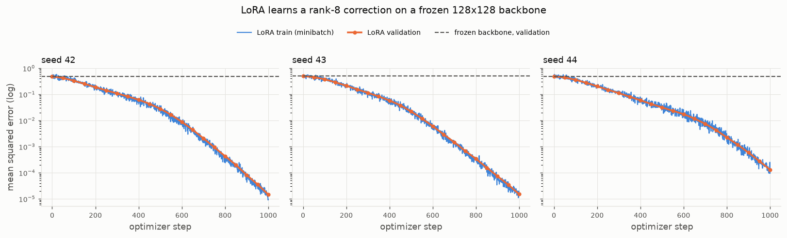

---

## 4. Phase 2 — dense Mixture-of-LoRA and the parameter-matched comparison

Source: [phase2_validation.md](phase2_validation.md),
[experiments/train_dense_molora.py](../experiments/train_dense_molora.py),
[experiments/benchmark_dense_molora.py](../experiments/benchmark_dense_molora.py),
[configs/dense_molora.yaml](../configs/dense_molora.yaml).

**Heterogeneous task.** Four regimes, one-hot coded in the last 4 of 128
input features; each regime has its own planted rank-8 correction `ΔW_z`
(‖·‖ = 0.5 ‖W0‖) on a shared frozen `W0`; 8 192 / 1 024 / 1 024 splits; batch
32, 2 000 Adam steps; learning rates from a validation-only pilot (1e-3 for
LoRA, 3e-3 for MoLoRA); criteria registered before the test run. The map
`x ↦ x ΔW_{z(x)}` is piecewise linear, so a single *linear* adapter of any
rank can only fit the regime-average correction plus a per-regime bias — this
is what makes the task separate routing from capacity.

**The parameter-matched comparison.** Dense MoLoRA (4 × r=8) has 8 708
trainable parameters; the matched single LoRA uses rank 34 (8 704, 4 fewer).

| seed | frozen | single LoRA r=8 (2 048) | **matched LoRA r=34 (8 704)** | **dense MoLoRA 4×8 (8 708)** |
|---|---|---|---|---|
| 42 | 0.4787 | 0.4189 | 0.3664 | 5.538e-4 |
| 43 | 0.4936 | 0.4338 | 0.3744 | 6.149e-4 |
| 44 | 0.4780 | 0.4177 | 0.3671 | 5.302e-4 |
| mean ± std | 0.4834 ± 0.0088 | 0.4235 ± 0.0090 | 0.3693 ± 0.0045 | (5.66 ± 0.44)e-4 |

Giving the single adapter 4.25× more parameters closes only 24 % of the frozen
error (0.424 → 0.369); routing with the same budget reaches 0.15 % of the
matched-LoRA error on every seed. Seed-42 rerun identical.

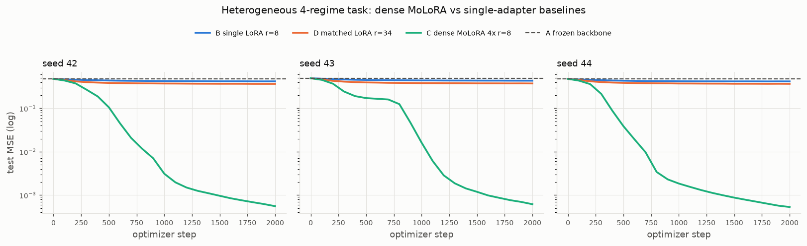

**Specialisation.** Each regime routes to one dominant expert with mean
probability 0.93–0.96, each expert owns exactly one regime, the assignment is a
different permutation per seed, entropy 0.22–0.32 nats (uniform 1.386),
argmax utilisation exactly 0.25 per expert without any balance loss, learned
expert norms 8.3–8.7 vs planted 8.0.

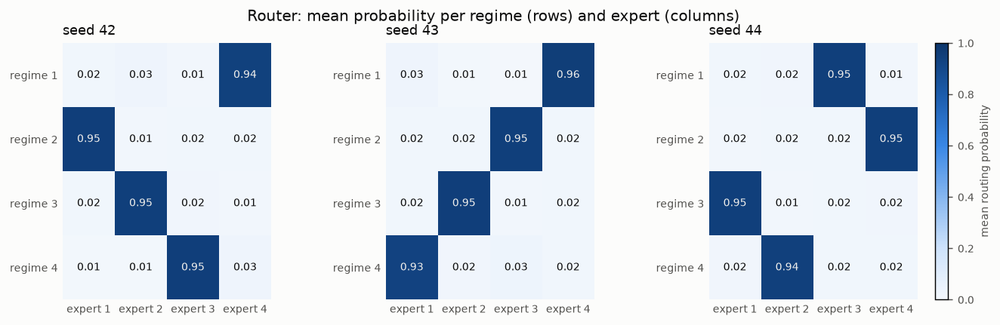

**Initialisation dynamics.** With zero-initialised `B` the router receives
exactly zero gradient on step 1 (verified) but experts diverge from step 1
because their `A_i` differ; router gradient norm peaks at 0.13–0.19 within
200–400 steps and decays to ≈ 2–3e-3 by step 2 000; entropy first rises
towards uniform then collapses to 0.26. Zero-`B` init did not prevent learning
in any seed; ablations with `b_init_std = 1e-3` (5.25e-4 mean) and a zero
router (6.47e-4) specialise identically.

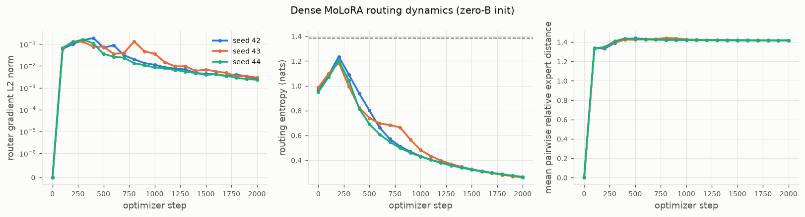

**Cost of dense routing** (unpinned BLAS, medians): forward 0.148 ms vs
0.030 ms for single LoRA at batch 32 (≈ 5×); training step 0.812 vs 0.230 ms
(≈ 3.5×); per-step peak Python allocation 0.95 vs 0.26 MB. Dense routing is
more expensive than any single adapter, as expected.

---

## 5. Phase 3 — sparse top-k routing: correctness, quality, cost

Source: [phase3_design.md](phase3_design.md),
[phase3_validation.md](phase3_validation.md),
[experiments/train_sparse_molora.py](../experiments/train_sparse_molora.py),
[experiments/benchmark_sparse_molora.py](../experiments/benchmark_sparse_molora.py),
[configs/sparse_molora.yaml](../configs/sparse_molora.yaml).

### 5.1 Correctness

Finite differences (float64, rtol 1e-6, atol 1e-7) pass for every `A_i`,
`B_i`, `W_g`, `b_g` and `x` at boundary-free inputs for `(E,k) ∈ {(3,2),(4,2),
(4,3)}`; a never-selected expert receives exactly zero gradient (reference) or
none at all (dispatch); each expert's gradient is the closed form restricted to
the tokens that selected it; top-1 exact has no router gradient while the
straight-through gradient matches the analytic softmax-Jacobian surrogate.
Reference vs dispatch: max |Δ forward| 7.1e-15, max |Δ gradient| 9.1e-13
(float64); identical 10-step Adam trajectories; `k=E` dispatch equals the
dense layer to 1e-12.

### 5.2 Predictive quality (same task and protocol as Phase 2; dispatch mode; 3 seeds)

Pilot (validation only): exact renormalised top-1 stayed at 0.43 for every
learning rate (its router never learns), straight-through top-1 reached
1.5e-13 at 3e-3; all sparse methods chose 3e-3.

| seed | frozen | LoRA r=8 | matched LoRA r=34 | dense 4×8 | sparse top-1 (STE) | sparse top-2 | sparse top-4 |
|---|---|---|---|---|---|---|---|
| 42 | 0.4787 | 0.4230 | 0.3664 | 6.057e-4 | 1.399e-13 | 4.189e-4 | 5.461e-4 |
| 43 | 0.4936 | 0.4331 | 0.3752 | 5.521e-4 | 6.206e-4 | 4.243e-4 | 5.925e-4 |
| 44 | 0.4780 | 0.4199 | 0.3664 | 5.278e-4 | 1.645e-13 | 4.100e-4 | 6.040e-4 |
| mean ± std | 0.4834 ± 0.0088 | 0.4253 ± 0.0069 | 0.3693 ± 0.0051 | 5.619e-4 ± 4.0e-5 | 2.069e-4 ± 3.6e-4 | **4.177e-4 ± 7.2e-6** | 5.809e-4 ± 3.1e-5 |

Top-2 is below dense on every seed (ratios 0.69 / 0.77 / 0.78) with half the
expert FLOPs; top-4 reproduces dense (0.90–1.14×; same function, different
init draw). Top-1 with the surrogate fits two seeds exactly but seed 43 shows
the brittleness of hard routing: one misrouted test token of 1 024 costs the
full regime error (test 6.2e-4 while validation was 1.3e-13). All
pre-registered criteria passed; seed-42 rerun identical.

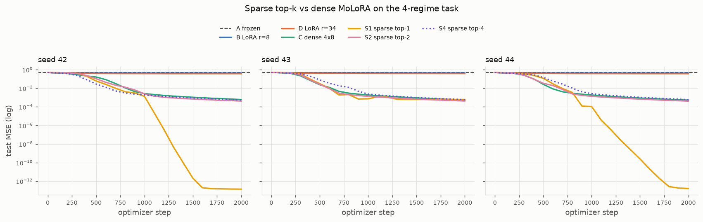
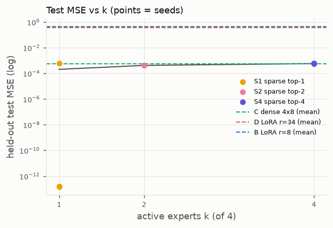

Routing: top-2 sends each regime to one dominant expert (selection rate 1.00,
weight ≈ 0.97) and spreads the second slot; top-1 learns a hard permutation
with utilisation exactly 0.25; top-4 equals dense.

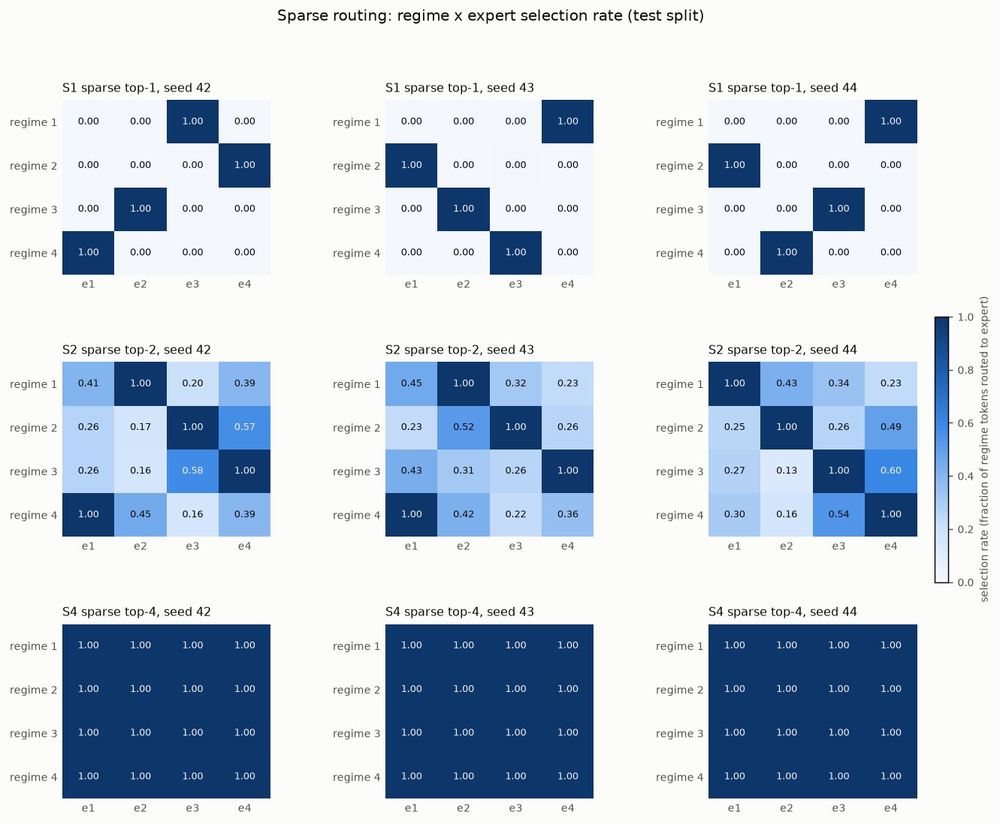

### 5.3 Scaling ablations (3 seeds, test MSE)

| variant | trainable | mean ± std | per seed |
|---|---|---|---|
| E=8, top-1 (STE) | 17 416 | 6.645e-3 ± 3.1e-3 | 8.0e-3 / 8.8e-3 / 3.1e-3 |
| E=8, top-2 | 17 416 | 3.133e-4 ± 1.4e-4 | 3.1e-4 / 1.8e-4 / 4.5e-4 |
| E=8, top-4 | 17 416 | 1.847e-3 ± 3.7e-4 | |
| E=8, top-8 (= dense) | 17 416 | 1.220e-3 ± 2.3e-4 | |
| E=4 top-2, rank 4 | 4 612 | 1.677e-1 ± 6.4e-4 | rank-4 cannot represent rank-8 corrections |
| E=4 top-2, rank 8 | 8 708 | 4.370e-4 ± 4.4e-5 | |
| E=4 top-2, rank 16 | 16 900 | 4.401e-4 ± 3.0e-5 | no gain from extra rank |

With more experts than regimes, top-1 collapses onto a subset (utilisation
0.01–0.25) and dense/top-4 leave a residual from split regimes; top-2 is the
most robust setting at both expert counts (its E=8 mean is lower than E=4 but
with 20× the spread, not established with 3 seeds).

### 5.4 Cost (pinned 1 BLAS thread, 128→128, medians; [phase3_validation.md §9](phase3_validation.md))

Absolute: at 512 tokens, step dense 2.12 ms vs sparse k=1 1.43 / k=2 2.22 /
k=4 2.80 ms; peak step allocation 12.1 vs 4.9 / 7.9 / 12.7 MB. Ratios:

| tokens | k=1 step / dense | k=2 step / dense | k=4 step / dense | k=1 fwd / dense | k=2 fwd / dense | k=1 peak / dense | k=2 peak / dense |
|---|---|---|---|---|---|---|---|
| 32 | 0.94 | 1.38 | 1.35 | 1.91 | 2.00 | 0.51 | 0.73 |
| 128 | 0.78 | 1.16 | 1.24 | 1.58 | 1.70 | 0.40 | 0.62 |
| 512 | 0.65 | 0.99 | 1.27 | 1.13 | 1.32 | 0.40 | 0.64 |
| 2048 | 0.53 | 0.93 | 1.31 | 0.88 | 1.18 | 0.39 | 0.64 |

The forward breakdown shows why: at 512 tokens the expert matmuls take
0.09 ms of a 0.73 ms sparse forward; gather/scatter and the router dominate.
Profiling showed `np.add.at` dominated dispatch before a unique-index fast
path was added (the dispatch share fell from 71 % to 23 % at 2 048 tokens).
Verdict (Task 3B.7 outcome 3): FLOP and memory savings always; wall-clock
savings only for small `k` at ≳ 512 tokens (training step) or ≳ 2 048 tokens
(forward).

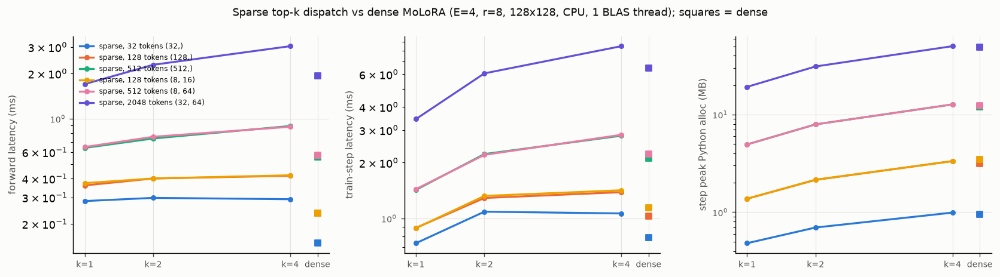

---

## 6. Phase 4A — 30-seed robustness and the balance-loss ablation

Source: [phase4a_robustness.md](phase4a_robustness.md),
[experiments/robustness_study.py](../experiments/robustness_study.py),
[configs/phase4_robustness.yaml](../configs/phase4_robustness.yaml).

**Why.** A Phase 3 rank sweep executed with Python's process-randomised
`hash()` for adapter seeding had shown top-2 settling in a poor optimum on 2
of 9 runs; the reproducible rerun did not. The discrepancy was investigated
with a frozen protocol: Phase 3 task and learning rates; seeds 1000–1029
(disjoint from 42–44); within a seed every method shares data, `W0` and
minibatch order and all MoE methods share identical initial experts and router
(paired, test-verified); failure pre-registered as validation MSE > 0.01 after
2 000 steps (≈ 2 % of the frozen error, ≈ 20× the converged level).

| method | params | test MSE mean | median | std | min | max | failures | exact 95 % CI |
|---|---|---|---|---|---|---|---|---|
| LoRA r=8 | 2 048 | 4.297e-1 | 4.289e-1 | 8.3e-3 | 4.14e-1 | 4.47e-1 | 30/30 (cannot route) | [0.884, 1.0] |
| LoRA r=34 | 8 704 | 3.732e-1 | 3.721e-1 | 6.9e-3 | 3.60e-1 | 3.88e-1 | 30/30 (cannot route) | [0.884, 1.0] |
| dense 4×8 | 8 708 | 5.457e-4 | 5.492e-4 | 2.6e-5 | 4.80e-4 | 6.18e-4 | **0/30** | [0, 0.116] |
| sparse top-2 | 8 708 | 4.263e-4 | 4.227e-4 | 4.2e-5 | 3.87e-4 | 6.35e-4 | **0/30** | [0, 0.116] |
| sparse top-1 (STE) | 8 708 | 2.000e-3 | 5.2e-13 | 8.3e-3 | 1.3e-13 | 4.59e-2 | **1/30** | [0.001, 0.172] |

Paired comparison with dense (10 000-resample bootstrap):

| method | mean Δ (method − dense) [CI] | median Δ [CI] | mean log10 ratio [CI] | seeds better than dense |
|---|---|---|---|---|
| sparse top-2 | −1.19e-4 [−1.34e-4, −1.00e-4] | −1.24e-4 [−1.34e-4, −1.10e-4] | −0.108 [−0.121, −0.092] | 29/30 |
| sparse top-1 (STE) | +1.45e-3 [−2.9e-4, +4.6e-3] | −5.25e-4 [−5.50e-4, −3.99e-4] | −5.62 [−7.22, −3.96] | 22/30 |

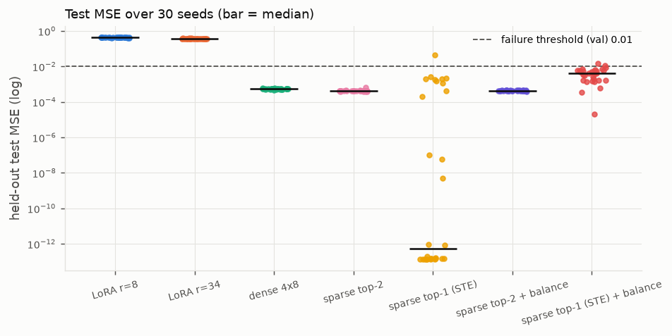
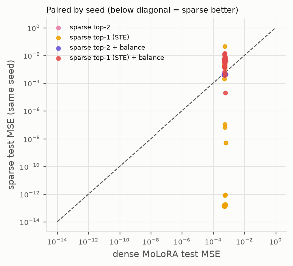

**Findings.** (i) Neither dense nor top-2 failed; the failure rate is below
11.6 % at 95 % confidence with a point estimate of 0, so the Phase 3
instability was an artefact of specific unreproducible initialisations.
(ii) Top-2's 22 % advantage over dense is consistent (29/30, CI away from 0)
but small in absolute terms. (iii) Top-1 straight-through is bimodal: 20/30
seeds exact (≈ 1.4e-13), 9/30 with 1–6 misrouted test tokens (1e-4 to 2e-3),
1/30 failed; its median beats dense, its mean does not — the statistic chosen
decides the verdict, which is itself the finding. (iv) 27/30 seeds start with
an initial dominant-expert collision; dense and top-2 resolved all of them.
(v) The single failure (seed 1011) plateaued at 0.20 for 1 200 steps while the
router gradient stayed at 0.1–0.2 and then began to resolve (0.043 at step
2 000, still falling): slow symmetry breaking after a collision — not expert
starvation (utilisation 0.23–0.26), not collapse (entropy 0.44), not optimizer
instability. These alternative hypotheses were tested on the diagnostics, not
assumed.

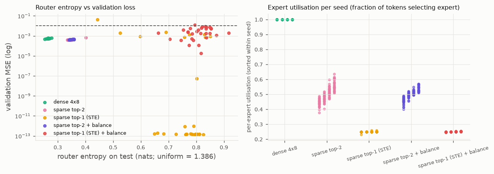
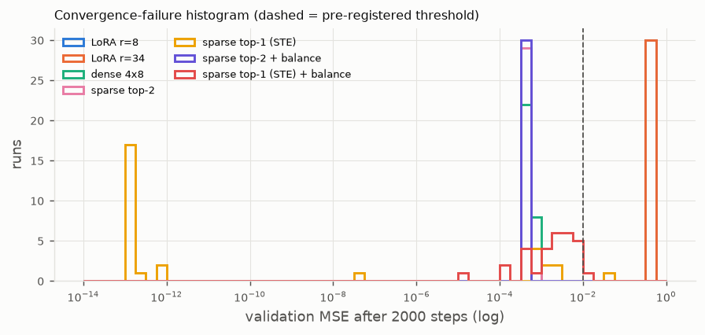

**Balance-loss ablation** (Switch-style `E Σ f_i P_i`, coefficient 0.01
chosen on disjoint validation seeds 2000–2004 by the pre-stated rule):

| method | mean test MSE | median | std | failures | seeds better than dense | utilisation min / max |
|---|---|---|---|---|---|---|
| sparse top-2 | 4.263e-4 | 4.227e-4 | 4.2e-5 | 0/30 | 29/30 | 0.44 / 0.56 |
| sparse top-2 + balance | 4.310e-4 | 4.287e-4 | 1.7e-5 | 0/30 | 30/30 | 0.46 / 0.54 |
| sparse top-1 (STE) | 2.000e-3 | 5.2e-13 | 8.3e-3 | 1/30 | 22/30 | 0.25 / 0.25 |
| sparse top-1 (STE) + balance | 4.464e-3 | 4.078e-3 | 3.3e-3 | 1/30 | 2/30 | 0.25 / 0.25 |

Neutral for top-2 (tighter spread, same failure rate, mean +5e-6); harmful for
top-1 (every run acquires misrouted tokens because the balance term keeps the
dense probabilities soft; one run drifted upward late in training).

---

## 7. Phase 4B — implicit regime discovery under controlled overlap

Source: [phase4b_latent_regime.md](phase4b_latent_regime.md),
[experiments/latent_regime_dataset.py](../experiments/latent_regime_dataset.py),
[experiments/train_latent_regime.py](../experiments/train_latent_regime.py),
[configs/phase4_latent_regime.yaml](../configs/phase4_latent_regime.yaml).

**Dataset.** `z ~ Uniform{1..4}` hidden; `x | z ~ N(δ u_z, I₁₂₈)` with
orthonormal `u_z`; `y = x (W0 + ΔW_z)` with rank-8 planted corrections. The
regime never enters the model inputs (tests assert unit within-regime variance
in every coordinate and independent splits). Separability = pairwise
Mahalanobis distance `Δ = δ√2`, fixed before any model ran, with
identifiability measured independently of the adapters:

| condition | Δ | Bayes-optimal regime accuracy | nearest-centroid accuracy | ambiguous fraction (max posterior < 0.9) |
|---|---|---|---|---|
| easy | 5.66 | 0.994 | 0.993 | 0.017 |
| medium | 2.83 | 0.825 | 0.822 | 0.523 |
| hard | 1.41 | 0.549 | 0.537 | 0.985 |

Oracles (planted corrections, perfect experts; diagnostic bounds, not
baselines): hard-Bayes `ΔW_{argmax p(z|x)}` and soft-Bayes `Σ_z p(z|x) ΔW_z`.
Primary sparse configuration chosen from Phase 4A before any 4B run: top-2,
exact gradient, no balance loss. 10 seeds per condition; learning rates from a
validation-only pilot (LoRA 1e-3, dense 3e-3, top-2 3e-3, top-1 1e-3).

**Held-out test MSE, mean [95 % bootstrap CI]:**

| condition | frozen | LoRA r=8 | LoRA r=34 | dense 4×8 | sparse top-2 | sparse top-1 (STE) | hard-Bayes oracle | soft-Bayes oracle |
|---|---|---|---|---|---|---|---|---|
| easy | 0.558 | 0.457 | 0.395 | 9.44e-3 [8.2e-3, 1.07e-2] | 9.79e-3 [8.3e-3, 1.14e-2] | 1.55e-2 [1.29e-2, 1.81e-2] | 6.80e-3 | 4.87e-3 |
| medium | 0.516 | 0.451 | 0.391 | 0.162 [0.147, 0.186] | 0.157 [0.153, 0.161] | 0.194 [0.188, 0.204] | 0.178 | 0.127 |
| hard | 0.505 | 0.445 | 0.387 | **0.318** [0.315, 0.322] | 0.342 [0.338, 0.345] | 0.416 [0.409, 0.423] | 0.456 | 0.289 |

| condition | sparse top-2 − dense [paired CI] | top-2 better | sparse top-1 − dense [CI] | top-1 better |
|---|---|---|---|---|
| easy | +3.5e-4 [+2.9e-5, +6.9e-4] | 3/10 | +6.0e-3 [+3.8e-3, +8.7e-3] | 0/10 |
| medium | −4.5e-3 [−2.8e-2, +7.8e-3] | 1/10 | +3.2e-2 [+5.1e-3, +5.2e-2] | 1/10 |
| hard | +2.35e-2 [+2.20e-2, +2.49e-2] | 0/10 | +9.8e-2 [+9.3e-2, +1.03e-1] | 0/10 |

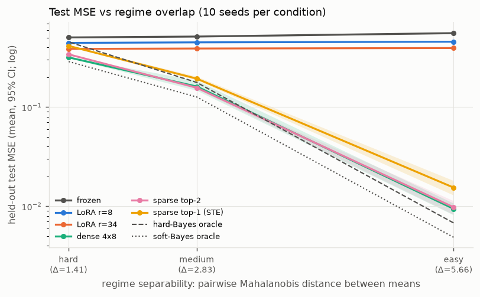

**Routing is learned from `x` alone.** Routing purity (fraction of tokens
routed to their regime's majority expert) equals the Bayes identification
accuracy in every condition — 0.990 / 0.806 / 0.519 for top-2 vs 0.994 /
0.825 / 0.549 — and the router's argmax agrees with the Bayes decision on
79–99 % of tokens; each expert takes one regime.

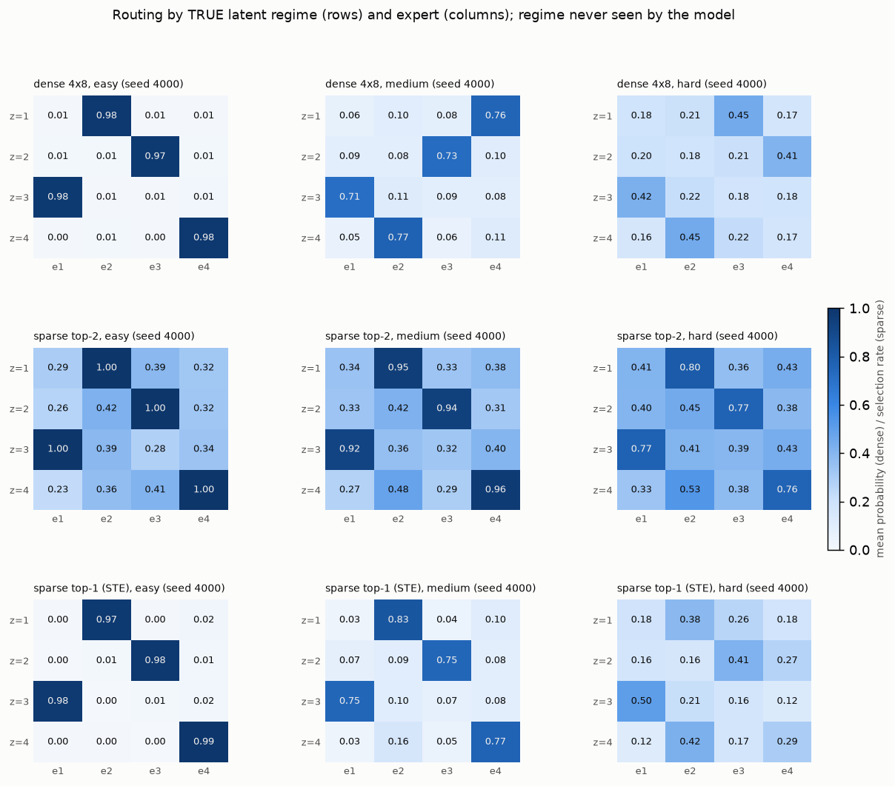

**Where sparse routing hurts.** Error concentrates on ambiguous inputs (easy:
4.3e-3 on unambiguous vs ≈ 0.3 on the 1.7 % ambiguous points for dense and
top-2). When 98.5 % of inputs are ambiguous (`hard`), the optimal predictor is
a *soft* mixture (soft-Bayes 0.289 < hard-Bayes 0.456); dense can mix all four
experts and beats top-2 on 10/10 seeds; top-1, which cannot mix at all, is
worst (0.416, ≈ the hard-Bayes oracle). In `medium` dense and top-2 tie, the
dense CI being wide because one dense seed (4002) left two regimes on one
expert (0.266 vs 0.14–0.16 elsewhere) — a dense convergence failure that did
not cross the registered threshold. Dense and top-2 both *beat* the hard-Bayes
oracle in medium and hard by mixing.

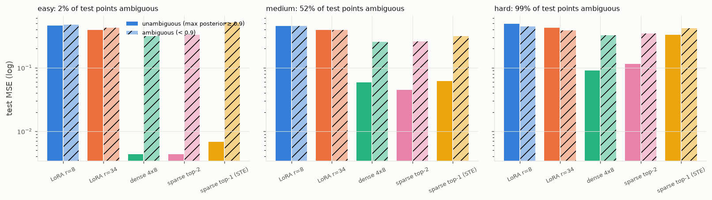

**Failure criterion.** The pre-registered threshold max(0.01, 2 × soft-oracle
validation MSE) evaluated to 0.010–0.014 in `easy`, where every converged run
sits at 2.1–3.4× the soft oracle, so it flagged near-floor runs (dense 1/10,
top-2 2/10, top-1 9/10); no run in any condition stalled near the frozen
error. The criterion is reported as registered; the continuous distributions
are the informative view.

---

## 8. Phase 4C — adapters inside a Needle transformer

Source: [phase4c_transformer.md](phase4c_transformer.md),
[experiments/sequence_task.py](../experiments/sequence_task.py),
[experiments/train_tiny_transformer.py](../experiments/train_tiny_transformer.py),
[experiments/benchmark_transformer.py](../experiments/benchmark_transformer.py),
[configs/phase4_transformer.yaml](../configs/phase4_transformer.yaml).

**Task.** Four latent first-order Markov processes over 16 tokens (85 % of
each row's mass on 3 "hot" tokens), sequences of length 32, process id never
given. Pretraining family `P_k`; adaptation family `P'_k = 0.5 P_k + 0.5 Q_k`
with process-specific shifts. Oracle cross-entropy 1.737 (pretraining) and
2.107 nats/token (adaptation); chance 2.773; the process is perfectly
identifiable from a full sequence.

**Backbone.** 2 layers, `d_model` 64, 4 heads, `d_ff` 128, 71 168 parameters,
1 500 Adam steps on 8 192 pooled sequences: pretraining test CE 1.845
(oracle 1.737), accuracy 0.295 (oracle 0.325). On the shifted data the frozen
backbone scores 2.836 / 0.167 — near chance, leaving real headroom.

**Adaptation protocol.** Adapters in `ffn.fc1`/`fc2` of both blocks (4
layers), rank 4, α 8, `E = 4`; dense 4×r=4 = 13 840 trainable (12 288 adapter +
1 552 router); matched single LoRA r=18 = 13 824; 800 Adam steps, batch 32,
4 096 adaptation sequences, 512 / 512 validation / test; lr 3e-3 for every
method from a validation-only pilot on a separate seed; 5 seeds (adapter init
and data order; shared backbone); sparse layers in dispatch mode.

| method | trainable | test CE mean ± std | min–max | test acc | Δ CE vs dense [95 % paired CI] | better than dense |
|---|---|---|---|---|---|---|
| frozen backbone | 0 | 2.8355 | — | 0.167 | +0.581 | — |
| LoRA r=4 | 3 072 | 2.3395 ± 0.0044 | 2.335–2.347 | 0.200 | +0.085 [+0.081, +0.089] | 0/5 |
| **LoRA r=18 (matched)** | 13 824 | 2.2679 ± 0.0028 | 2.263–2.270 | 0.206 | +0.0133 [+0.0120, +0.0150] | 0/5 |
| **dense MoLoRA 4×r=4** | 13 840 | 2.2546 ± 0.0033 | 2.250–2.259 | 0.207 | — | — |
| **sparse top-2** | 13 840 | 2.2549 ± 0.0055 | 2.251–2.264 | 0.208 | +0.0003 [−0.0024, +0.0029] | 2/5 |
| sparse top-1 (STE) | 13 840 | 2.2941 ± 0.0034 | 2.290–2.299 | 0.204 | +0.0395 [+0.0376, +0.0406] | 0/5 |

All 71 168 backbone parameters stayed bit-identical in every run; sparse
top-2 executed exactly 50 % of the dense adapter FLOPs in every layer. The
adapters close ≈ 80 % of the frozen-to-oracle gap. Dense and sparse top-2 are
statistically indistinguishable, and both beat the parameter-matched LoRA by
0.013 nats on 5/5 seeds — a real but small routing benefit at this scale.
Routers are far from uniform (entropy 0.26–0.55 per layer) but, with a
sequence-level latent and per-token FFN adapters, do not form a clean
one-expert-per-process permutation. Query/value-projection adapters are
implemented and tested but were **not** evaluated.

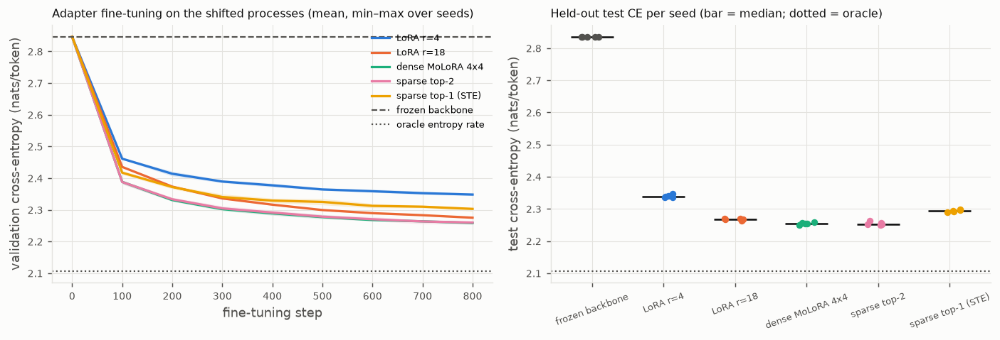

**Systems benchmark** (1 BLAS thread, 20 repeats, medians; selected rows):

| B | T | method | forward ms | step ms | train tok/s | step peak MB | adapter share of forward | adapter ms (router / expert / dispatch) |
|---|---|---|---|---|---|---|---|---|
| 32 | 32 | frozen | 7.81 | 8.71 | 117 522 | 3.4 | 0 % | 0 |
| 32 | 32 | LoRA r=4 | 10.26 | 23.01 | 44 501 | 58.7 | 20 % | 1.96 |
| 32 | 32 | dense E=4 | 14.84 | 38.85 | 26 355 | 112.7 | 42 % | 5.53 |
| 32 | 32 | sparse E=4 k=1 | 15.20 | 39.91 | 25 656 | 77.3 | 45 % | 7.07 (1.60 / 0.71 / 1.96) |
| 32 | 32 | sparse E=4 k=2 | 17.48 | 50.33 | 20 344 | 93.9 | 50 % | 8.17 (1.82 / 1.03 / 2.39) |
| 32 | 32 | dense E=8 | 19.85 | 55.70 | 18 385 | 174.5 | 57 % | 11.18 |
| 32 | 32 | sparse E=8 k=2 | 18.98 | 59.16 | 17 308 | 108.1 | 55 % | 10.14 (2.29 / 1.34 / 3.05) |
| 8 | 16 | dense E=4 | 4.01 | 13.65 | 9 375 | 15.1 | 43 % | 1.72 |
| 8 | 16 | sparse E=4 k=2 | 5.46 | 18.42 | 6 948 | 11.9 | 56 % | 3.03 (0.85 / 0.35 / 0.89) |

MoE adapter layers are 42–57 % of the forward in this small model (LoRA:
17–23 %), yet inside the sparse layers router + gather/scatter (1.6–4.3 ms)
exceed the expert matmuls saved (0.3–1.3 ms). Across the four shapes the
sparse training step is 0.80–1.09× dense for `k=1`, 0.98–1.35× for `k=2`,
1.19–1.69× for `k=4`; inference forward 1.0–1.4× dense. **No end-to-end
speedup.** Peak step allocation is 67–69 % (`k=1`) and 79–83 % (`k=2`) of
dense; with `E=8`, sparse `k=2` uses 62 % of dense E=8 memory at 6 % higher
step time.

---

## 9. Cross-phase synthesis: when sparse routing helps, when it hurts

**Capacity is not the issue; input dependence is.** On every task with
regime-dependent corrections, a single linear adapter plateaus regardless of
rank (0.37–0.46 MSE in all regression tasks; 2.268 vs 2.255 nats in the
transformer), while routed adapters of the *same* trainable size learn the
input-dependent correction. This is the clearest and most robust result in
the project (Phases 2, 3, 4A, 4B, 4C; 30 + 30 + 30 + 5 seeds).

**Sparse top-2 vs dense depends on how certain the routing decision can be.**

| setting | routing certainty | sparse top-2 vs dense | evidence |
|---|---|---|---|
| explicit regime code | deterministic | top-2 better: 29/30 seeds, −22 % (CI away from 0) | §6 |
| latent regimes, Δ = 5.66 | Bayes acc 0.994 | ≈ tie (dense +3.5e-4 better on a 9.4e-3 base) | §7 |
| latent regimes, Δ = 2.83 | Bayes acc 0.825 | tie (CI spans 0) | §7 |
| latent regimes, Δ = 1.41 | Bayes acc 0.549 | **dense better 10/10** (+7 %) | §7 |
| transformer, latent process | sequence-level | tie (Δ +0.0003, CI spans 0) | §8 |

Interpretation (supported): when the regime is identifiable, renormalising
over two experts removes the soft-gate dilution that costs dense ≈ 5 %
weight per regime, so top-2 fits slightly better with half the expert
compute; when inputs are ambiguous, the optimal predictor is a soft mixture
over *all* experts and restricting to two is a representational loss. Top-1
takes this to the extreme: exact fits on clean regimes, the worst routed
method everywhere else, bimodal across seeds, and untrainable without a
surrogate gradient.

**Efficiency.** Executed adapter FLOPs are exactly `k/E` of dense and
per-step activation memory falls accordingly (40–83 % of dense depending on
`k`, `E` and model), in every configuration measured. Wall-clock time does
not follow: on this Needle/NumPy CPU stack the fixed per-expert cost of
gather, scatter and router (Python-level op overhead plus NumPy indexing)
exceeds the matmul work saved unless `k = 1` and ≥ 512 tokens pass through a
single layer; inside a transformer with 128–1 024 tokens per adapter layer no
configuration was faster than dense. The memory saving is the systems benefit
that survives; whether the FLOP saving becomes a time saving on a compiled or
GPU backend was not measured and is not claimed.

---

## 10. Supported conclusions, hypotheses, and limitations

**Supported by the measurements (with the stated uncertainty):**

1. Routed LoRA adapters (dense or sparse) outperform a parameter-matched
   single LoRA whenever the required correction is input-dependent
   (Phases 2–4C; CIs exclude zero in every case).
2. Sparse top-2 is never worse than dense on separable regimes and is better
   with an explicit regime code (29/30 seeds, mean −1.19e-4 [−1.34e-4,
   −1.00e-4]); it is worse than dense under heavy regime overlap (10/10
   seeds, +2.35e-2 [+2.20e-2, +2.49e-2]).
3. Dense and sparse top-2 do not fail to converge under the frozen protocol
   (0/30 each; 95 % CI < 11.6 %); the Phase 3 failures were a seeding
   artefact.
4. Exact renormalised top-1 cannot train its router; straight-through top-1
   is bimodal and brittle (misrouted tokens cost the full regime error).
5. The Switch-style balance loss is neutral for top-2 and harmful for top-1
   on tasks with balanced regimes.
6. The router recovers latent regimes at Bayes-level purity from inputs
   alone.
7. Sparse dispatch executes exactly `k/E` of the dense adapter FLOPs and
   lowers per-step peak allocation consistently, but yields no end-to-end
   wall-clock gain in the transformer and only `k=1`, ≥ 512-token gains in
   an isolated layer, on this CPU stack.

**Hypotheses consistent with the data but not established:**

* E=8 top-2 may be better than E=4 top-2 (3 seeds, 20× spread).
* Top-2 convergence failures exist for some initialisation draws (seen only
  in the non-reproducible run); their frequency is unquantified beyond the
  < 11.6 % bound for the Xavier/zero-`B` policy.
* A fused or batched expert kernel would move the sparse break-even point.
* The small transformer routing benefit (0.013 nats) would grow with model
  depth or sequence-aware routing.

**Limitations.** All tasks are synthetic with planted low-rank corrections;
regimes are isotropic Gaussians with orthogonal means or a 16-token Markov
family; the transformer has 71 k parameters, two layers and FFN-only
adapters; seeds: 3 (Phases 1–3), 30 (4A), 10 per condition (4B), 5 (4C); one
initialisation policy; learning rates tuned once on validation data; the 4B
failure threshold proved too tight in `easy`; memory is Python/NumPy peak
allocation per step (not process RSS, not GPU memory); timings reflect
Needle's Python op graph; q/v adapters, real text, auxiliary-loss variants
beyond one coefficient, and QLoRA (not implemented) were not evaluated.

---

## 11. Reproducibility

Environment: [needle_environment.md](needle_environment.md); tests:
`python -m pytest` (384). All experiment commands and run directories are
listed in the phase reports; configurations are in
[configs/](../configs/). Seeds, learning-rate pilots and pre-registered
criteria are recorded in each config.

| phase | report | main scripts |
|---|---|---|
| 1 | [phase1_validation.md](phase1_validation.md) | [train_synthetic.py](../experiments/train_synthetic.py) |
| 2 | [phase2_validation.md](phase2_validation.md) | [train_dense_molora.py](../experiments/train_dense_molora.py), [benchmark_dense_molora.py](../experiments/benchmark_dense_molora.py) |
| 3 | [phase3_design.md](phase3_design.md), [phase3_validation.md](phase3_validation.md) | [train_sparse_molora.py](../experiments/train_sparse_molora.py), [benchmark_sparse_molora.py](../experiments/benchmark_sparse_molora.py) |
| 4A | [phase4a_robustness.md](phase4a_robustness.md) | [robustness_study.py](../experiments/robustness_study.py) |
| 4B | [phase4b_latent_regime.md](phase4b_latent_regime.md) | [latent_regime_dataset.py](../experiments/latent_regime_dataset.py), [train_latent_regime.py](../experiments/train_latent_regime.py) |
| 4C | [phase4c_transformer.md](phase4c_transformer.md), [phase4_summary.md](phase4_summary.md) | [sequence_task.py](../experiments/sequence_task.py), [train_tiny_transformer.py](../experiments/train_tiny_transformer.py), [benchmark_transformer.py](../experiments/benchmark_transformer.py) |
