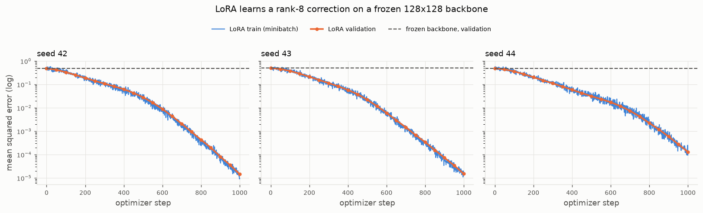

# Phase 1 validation report — native LoRA in Needle

Date: 2026-11-08. Branch `feature/phase0-phase1-lora`. All numbers below were
produced by the commands shown; nothing is estimated.

## 1. Environment

| Item | Value |
|---|---|
| Host | Linux 6.12.0 x86_64, AMD EPYC 9334 (128 logical CPUs), 377 GB RAM |
| Python | 3.13.14, project venv `.venv` |
| Packages | numpy 2.5.4, pyyaml 6.0.3, pytest 9.2.0, matplotlib 3.11.2 |
| Device | CPU only (`needle.cpu()`); no GPU used |
| Experiment wall time | ≈ 0.3 s per 1000-step run (see §8) |

## 2. Needle source

`~/projects/dlsys/hw2/python/needle` — the completed 10-714 Homework 2
implementation (NumPy backend). The coursework directory is not a git
repository, so no commit hash exists; it was verified by its own test suite
(87/88 nn+optim tests pass, the failure being a tensor-allocation-count check;
29/29 hw1 autograd tests pass). Details: [needle_environment.md](needle_environment.md).
Needle was not modified.

## 3. Implementation summary (`molora/lora.py`)

`LoRALinear(in_features, out_features, rank=8, alpha=16.0, bias=True, device, dtype, *, base_weight, base_bias)`

    forward(x) = x @ W0 + broadcast(b) + ((x @ A) @ B) * (alpha / rank)

* Orientation follows Needle's `nn.Linear` (`weight: (in, out)`, `y = x @ W`),
  which matches the paper's row-vector form, so `A: (in, r)`, `B: (r, out)`.
* Init: `W0` Kaiming-uniform (same as `nn.Linear`) or imported; `A`
  Kaiming-uniform via `init.kaiming_uniform(in, r)`; `B = 0`; scaling `alpha / r`.
* `from_linear(linear, rank, alpha)` reuses the wrapped layer's weight and bias
  storage (verified with `np.shares_memory`); the original module is untouched.
* Leading batch dimensions are arbitrary; `(..., in) -> (..., out)` is tested
  for 1-, 2- and 3-D batch shapes.
* Validation rejects non-positive / non-integer dimensions and rank, `rank >
  min(in, out)`, non-positive / non-finite / non-numeric alpha, `base_bias`
  with `bias=False`, and shape-mismatched imported tensors.
* Accounting: `num_base_parameters` (= `in·out + out·[bias]`),
  `num_adapter_parameters` (= `r (in + out)`), `num_total_parameters`,
  `trainable_ratio`, `parameter_summary`. Utilities: `load_adapter`,
  `delta_weight`, `effective_weight`, `effective_bias`.

## 4. Parameter-freezing strategy

Needle's optimizers update whatever list they are given and its autograd writes
`.grad` on every visited node regardless of `requires_grad`
(`requires_grad=False` only detaches an op whose inputs are *all* constants).
Setting the flag is therefore necessary but not sufficient. The layer:

1. stores `W0` and `b` as `Parameter`s with `requires_grad=False` and
   `grad = None` (so Needle optimizers tolerate them if they ever receive them);
2. exposes `adapter_parameters() -> [A, B]` (and `trainable_parameters()`,
   `frozen_parameters()`, plus module-level `freeze_module` /
   `trainable_parameters(model)` for composite models);
3. is documented and tested such that **the optimizer must be constructed from
   `adapter_parameters()` / `trainable_parameters(model)`**.

Two characterisation tests pin down the pitfall: when the layer input requires a
gradient, `W0.grad` is populated and an optimizer given `layer.parameters()`
*would* change `W0` (`test_passing_all_parameters_to_optimizer_would_update_base_when_input_requires_grad`,
`test_requires_grad_false_is_not_sufficient_in_needle`), whereas the documented
usage leaves it bit-identical.

## 5. Tests executed

Command: `python -m pytest` (repository root, venv active).

| File | Tests | Result |
|---|---|---|
| `tests/test_environment.py` | 15 | 15 passed |
| `tests/test_lora_forward.py` | 42 | 42 passed |
| `tests/test_lora_backward.py` | 12 | 12 passed |
| `tests/test_lora_training.py` | 10 | 10 passed |
| **total** | **79** | **79 passed, 0 failed, 0 skipped** (0.1 s) |

Forward coverage (Task 1.6): output shapes for batch shapes `(1,)`, `(5,)`,
`(2,3)`, `(2,3,4)`; `B == 0` and `ΔW == 0` at init; initial output equals
`x W0 + b` (bias on/off, 2-D and 3-D input); `from_linear` output equals the
wrapped `Linear` to `rtol 1e-6`; output equals `x (W0 + s·AB) + b` with random
non-zero `B` for `(in,out,r) ∈ {(6,4,2),(4,6,1),(16,16,8),(5,3,3)}` and against
a float64 NumPy reference (`rtol 1e-5`); ranks 1/2/4/8 give `r(in+out)` adapter
parameters and `scaling = alpha/r`; doubling alpha doubles the correction; bias
is frozen and counted as base; float64 layers; 13 invalid configurations raise
`ValueError`/`TypeError`; wrong input width raises.

Frozen-parameter coverage (Task 1.8): for Adam (lr 1e-2) and SGD (lr 1e-1),
bias on/off, 5 consecutive steps: `W0` and `b` bit-identical after every step
(`assert_array_equal`), `A` and `B` both changed, loss and gradients finite,
loss decreased; optimizer `params` are exactly `[A, B]` by identity;
counts match tensor shapes and the formula for three layer sizes; `from_linear`
training leaves the original `Linear` untouched; a frozen backbone `Linear` +
LoRA layer in `nn.Sequential` trains only the adapter; two runs under the same
seed are bit-identical.

## 6. Numerical gradient checks (Task 1.7)

Loss `L = Σ (y − T)²` with a fixed random target `T` (non-linear in `y`);
layer `5→4`, rank 2, alpha 3, **B deliberately non-zero** so that `∂L/∂A ≠ 0`.
Central differences `(L(p+ε) − L(p−ε)) / 2ε` per entry.

| Check | dtype | ε | Tolerance | Outcome |
|---|---|---|---|---|
| FD vs autograd for `A`, `B`, `x`; bias on/off; batch `(3,)` and `(2,3)` | float64 | 1e-6 | rtol 1e-6, atol 1e-8 | pass (4 parametrisations) |
| FD for `B` at default init (`B = 0`), and `∂L/∂A == 0` exactly there | float64 | 1e-6 | rtol 1e-6, atol 1e-8 | pass |
| autograd vs closed-form `∂L/∂A = s xᵀ(G Bᵀ)`, `∂L/∂B = s (xA)ᵀ G`, `∂L/∂x = G W0ᵀ + s (G Bᵀ)Aᵀ` | float64 | — | rtol 1e-10 | pass |
| same closed form | float32 | — | rtol 1e-4, atol 1e-4 | pass (2 batch shapes) |
| float32 autograd vs FD evaluated in float64 on the same values | float32 | 1e-6 | rtol 1e-4, atol 1e-4 | pass |
| float32 autograd vs **pure float32** FD | float32 | 1e-2 | rtol 2e-2, atol 2e-2 | pass |
| stacked `LoRALinear(5→6) → LoRALinear(6→3)`, FD on first layer's `A` | float64 | 1e-6 | rtol 1e-6, atol 1e-8 | pass |

Discrepancies: none beyond precision. Float32 autograd agrees with the
float64 reference to ~1e-4 relative, as expected from single-precision
accumulation over 5-dimensional products; pure float32 finite differences are
limited by cancellation (`ε² + eps_machine/ε`) to ~1e-2 and are included only
to document that limit. With a constant input, `W0.grad` and `b.grad` remain
`None`; with a gradient-requiring input (second layer of the stack) `W0.grad`
is populated by Needle — harmless as long as the optimizer never receives it
(§4). Needle also writes `.grad` on a constant input leaf reached through the
adapter path; that is engine behaviour, not a defect of the layer.

## 7. Synthetic experiment setup (Tasks 1.9–1.10)

`experiments/train_synthetic.py --config configs/lora_baseline.yaml`

* Teacher: `y = x (W0 + ΔW*)`, `x ~ N(0, I₁₂₈)`, `ΔW* = c·A*B*`, `A*: 128×8`,
  `B*: 8×128` standard normal, `c` chosen so `‖ΔW*‖_F = 0.5 ‖W0‖_F`
  (`delta_rel_norm: 0.5`); no label noise; no bias.
* `W0` from `nn.Linear(128, 128, bias=False)` under `np.random.seed(seed)`; the
  student is `LoRALinear.from_linear(base, rank=8, alpha=16.0)` sharing `W0`.
* Data: 4096 training / 1024 held-out validation samples, drawn with
  `np.random.default_rng(seed)`; minibatches of 32 from per-epoch permutations.
* Optimizer: Needle `Adam`, lr 1e-3, on `adapter_parameters()` only; 1000 steps;
  validation MSE every 50 steps. **No optimisation setting was changed from the
  initial configuration.**
* Baseline: the frozen backbone alone (`x W0`), evaluated on the same splits.
* Seeds 42, 43, 44; seed 42 is rerun once for reproducibility.
* Success criteria recorded in the config before the run: LoRA validation MSE
  ≤ 0.10 × baseline validation MSE on every seed; final training MSE below the
  initial training loss; validation improved over baseline; frozen parameters
  bit-identical; all values finite; rerun agrees to rtol 1e-6.

Each run writes `config.yaml`, `results.json` (full loss histories, parameter
counts, seeds, runtime, environment incl. git commit), `summary.md`, and
`loss_curve.png` to `outputs/lora_synthetic/<timestamp>/` (git-ignored).

## 8. Measured results (confirmatory run `outputs/lora_synthetic/20261108-145153`)

Parameters per run: base (frozen) 16 384, adapter (trainable) 2 048, total
18 432, trainable ratio 0.125.

| seed | baseline val MSE | LoRA val MSE | ratio | rel. ‖ΔW − ΔW*‖/‖ΔW*‖ | initial train loss | final train MSE (full set) | CPU time (s) | W0 unchanged |
|---|---|---|---|---|---|---|---|---|
| 42 | 0.4867 | 1.470e-05 | 3.02e-05 | 5.39e-03 | 0.5398 | 1.213e-05 | 0.29 | yes |
| 43 | 0.5002 | 1.513e-05 | 3.03e-05 | 5.58e-03 | 0.5040 | 1.264e-05 | 0.28 | yes |
| 44 | 0.4890 | 1.308e-04 | 2.68e-04 | 1.67e-02 | 0.5548 | 1.176e-04 | 0.28 | yes |

Repeat of seed 42: final validation MSE 1.469549e-05 in both runs (identical).

Validation MSE trajectory (seed 42): 0.4867 (step 0) → 0.4192 (50) → 0.3326
(100) → 0.1877 (200) → 1.47e-05 (1000); the other seeds follow the same shape
(figure below, `docs/figures/phase1_loss_curve.png`).

Criteria: `val_mse_ratio_below_threshold` PASS · `train_loss_decreased` PASS ·
`val_loss_improved_over_baseline` PASS · `frozen_params_unchanged` PASS ·
`all_values_finite` PASS · `reproducible` PASS → **all passed**.

Interpretation: the adapter recovers the planted rank-8 correction to within
0.5–1.7 % relative Frobenius error and reduces held-out MSE by more than four
orders of magnitude (≥ 99.97 %) relative to the frozen backbone, with `W0`
bit-identical before and after training. The curves are still descending at
step 1000; no claim is made about the asymptotic floor.

## 9. Known limitations

* CPU / NumPy backend only; no GPU timing, throughput or memory measurements
  exist. The 0.125 trainable ratio is a parameter count, **not** a memory
  saving claim — activations and the frozen `W0` dominate memory here, and
  Needle still materialises `W0.grad` when the layer input requires a gradient.
* Freezing relies on the caller using `adapter_parameters()` /
  `trainable_parameters(model)`; Needle offers no engine-level guard.
* Gradient checks use small layers (5→4, 6→3); the 128×128 benchmark relies on
  the same code path but was not finite-difference checked.
* The benchmark is noise-free and exactly realisable (target rank = LoRA rank);
  it validates the implementation, not LoRA's statistical behaviour.
* No `named_parameters` / state-dict serialisation; adapters are saved and
  loaded through `load_adapter` with NumPy arrays only.

## 10. Readiness for Phase 2

Ready. The pieces Phase 2 (dense Mixture-of-LoRA) needs are in place: a
tested adapter primitive with explicit trainable-parameter access, batch-dim
support, a router can be expressed with existing Needle ops
(`matmul`, `logsoftmax`, `exp`, `broadcast_to`), and a mixture of `n` experts
is a sum of `n` scaled `x A_i B_i` terms. The first Phase 2 task is a
`MoLoRALinear(in, out, n_experts, rank, alpha)` with a softmax router over
per-token gates, reusing this report's forward / finite-difference / freezing
test structure, and a parameter-accounting extension for the router. Sparse
top-k routing (Phase 3) additionally needs a `topk`/masking op that Needle
lacks (see needle_environment.md §5).
