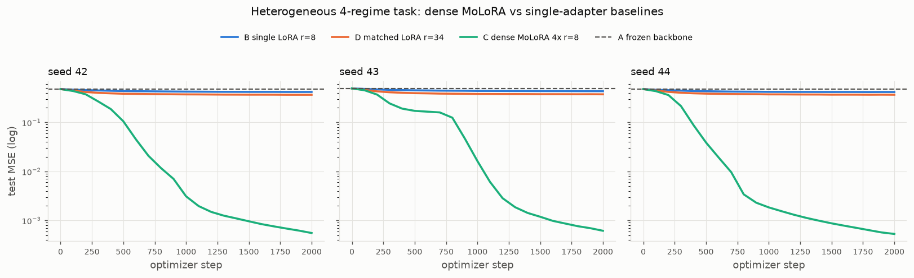
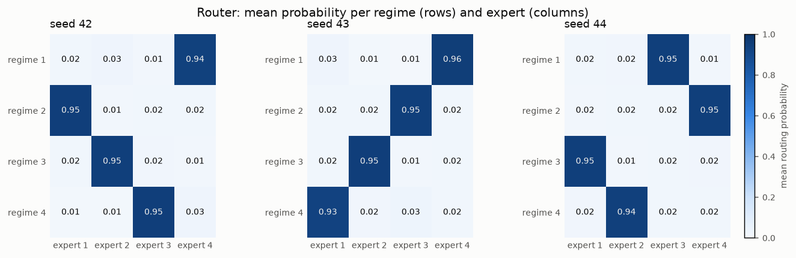
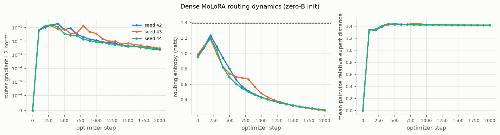

# Phase 2 validation report — dense Mixture-of-LoRA experts in Needle

Date: 2026-11-08. Branch `main`. Every number below comes from the commands
shown; run directories are listed so results can be traced. CPU only.

## 1. Architecture and mathematical specification

For an input row vector `x ∈ R^{d_in}` and `E` experts:

    y = x W0 + b + Σ_{i=1..E} g_i(x) · (α / r) · x A_i B_i
    g(x) = softmax((x W_g + b_g) / T)

| symbol | shape | status |
|---|---|---|
| `W0` | `(d_in, d_out)` | frozen, shared by all experts |
| `b` | `(d_out,)` | frozen, optional |
| `A_i` | `(d_in, r)` | trainable, Kaiming-uniform init (Needle `kaiming_uniform`) |
| `B_i` | `(r, d_out)` | trainable, zero init (exact zero adapter contribution at init) |
| `W_g`, `b_g` | `(d_in, E)`, `(E,)` | trainable router, Xavier-uniform / zeros init |
| `T` | scalar | router temperature, `T > 0` |

Needle's `nn.Linear` convention (`weight: (in, out)`, `y = x @ W`) matches
the row-vector form, so no transposes are needed. All `E` experts are
evaluated on every input (dense routing); `g(x)` is computed per routed
position (token granularity) and sums to one over the expert axis.

Implementation: [`molora/dense_molora.py`](../molora/dense_molora.py)
(`LoRAExpert`, `DenseMoLoRALinear`) and [`molora/router.py`](../molora/router.py)
(`softmax`, `DenseSoftmaxRouter`). `DenseMoLoRALinear.from_linear(linear, **kw)`
wraps an existing `needle.nn.Linear` sharing its weight and bias storage, as
in Phase 1. `forward(x)` returns `y`; `forward_with_routing(x)` returns
`(y, gates)` with the graph-bearing gate tensor so routing can be inspected or
regularised without caching anything across iterations;
`router_probabilities(x)` returns a detached NumPy array for diagnostics.

### Needle-specific design decisions

* **Softmax.** Needle's `logsoftmax` op normalises over axis 1 unconditionally,
  which is wrong for `(batch, seq, E)` inputs. The router therefore uses
  `exp(z − broadcast(logsumexp(z, axes=(−1,))))`, which is numerically stable
  and built from ops with tested gradients. It is verified against NumPy on
  2-, 3- and 4-D inputs and with finite differences.
* **Gate extraction.** Needle has no slicing, gather or stack op. The i-th
  gate column is read as `gates @ e_i` with a constant one-hot `(E, 1)`
  selector, then broadcast to the expert output shape. This is differentiable
  through `matmul` and works for any number of leading dimensions.
* **Experts do not duplicate the backbone.** `LoRAExpert` holds only `A_i`,
  `B_i`; `x W0` is computed once per forward. The Phase 1 `LoRALinear` is left
  untouched, and its `_frozen_parameter` / `_to_tensor` helpers are reused.
* **Simple expert loop.** The forward is an explicit loop over experts; no
  batched/stacked computation and no custom kernels (Phase 2 scope).

## 2. Parameter accounting

`P_train = E r (d_in + d_out) + d_in E + E`. For the default configuration
(E = 4, r = 8, 128 → 128, no bias):

| group | formula | count |
|---|---|---|
| frozen backbone | `d_in d_out` | 16 384 |
| adapters | `E r (d_in + d_out)` | 8 192 |
| router | `d_in E + E` | 516 |
| trainable | adapters + router | **8 708** |
| total | | 25 092 |

`test_default_configuration_counts` and `test_parameter_accounting` (12
`(E, r)` combinations) verify these against the registered tensors;
`trainable_parameters()` is asserted to be duplicate-free and to exclude the
backbone.

## 3. Backbone freezing

Unchanged from Phase 1 (see [phase1_validation.md §4](phase1_validation.md)):
frozen tensors are `Parameter`s with `requires_grad=False` and `grad = None`;
the optimizer is built from `trainable_parameters()` = adapters + router.
Needle still writes `W0.grad` when the layer input requires a gradient (second
layer of a stack); `test_training_in_a_stack_with_gradient_requiring_input`
shows the weight stays bit-identical because it is never handed to the
optimizer. Every confirmatory run asserts `W0` is `array_equal` before and
after training.

## 4. Tests executed

Command: `python -m pytest` (repository root, venv active).

| File | Tests | Result |
|---|---|---|
| Phase 1 (`test_environment`, `test_lora_*`) | 79 | 79 passed (unchanged) |
| `tests/test_router.py` | 20 | 20 passed |
| `tests/test_dense_molora_forward.py` | 59 | 59 passed |
| `tests/test_dense_molora_backward.py` | 9 | 9 passed |
| `tests/test_dense_molora_training.py` | 9 | 9 passed |
| **total** | **176** | **176 passed, 0 failed, 0 skipped** (0.3 s) |

### Forward correctness
Output `(…, d_out)` and gate `(…, E)` shapes for batch shapes `(1,)`, `(5,)`,
`(2,3)`, `(2,3,4)`; gates finite, in `[0,1]`, summing to one (atol 1e-5 in
float32 with large logits); initial output equals `x W0 + b` (bias on/off, 2-D
and 3-D); `from_linear` shares storage and matches the wrapped `Linear` to
rtol 1e-6; an **independent float64 NumPy oracle** (per-expert low-rank
outputs, NumPy softmax, weighted sum) matches to rtol 1e-11 for
`(E, r) ∈ {(1,2),(3,1),(4,2),(5,3)}`, bias on/off, 2-D and 3-D inputs, with
random non-zero experts and router and `T = 0.7`; float32 matches to 1e-4;
one-expert mixture equals `LoRALinear` with the same `A, B` (gate exactly 1);
higher temperature raises entropy and changes outputs; 12 invalid
configurations raise.

### Backward correctness (float64 central differences, ε = 1e-6, rtol 1e-6, atol 1e-7)
With deterministic non-zero `A_i, B_i, W_g, b_g` (3 experts, 5 → 4, r = 2,
`T = 0.8`, loss `Σ(y − T)²`), for bias on/off and batch shapes `(3,)`, `(2,3)`:
every `A_i`, every `B_i`, `W_g`, `b_g` and `x` match finite differences and
are non-zero. At the default zero-`B` init: `∂L/∂B_i` matches finite
differences and is non-zero; `∂L/∂A_i = 0` and `∂L/∂W_g = ∂L/∂b_g = 0`
**exactly**; `W0.grad`, `b.grad` are `None`. With all experts identical the
router gradient is 0 (atol 1e-12) while expert gradients are non-zero; once
`B_i` differ the router gradient norm exceeds 1e-6. Float32 autograd agrees
with the float64 oracle to 1e-3. No unexplained discrepancies.

### Freezing / optimizer
Adam (lr 1e-2) and SGD (lr 1e-1), bias on/off, 6 steps: `W0`, `b`
bit-identical after every step; every `A_i`, `B_i` and both router tensors
moved; router gradient exactly 0 on step 1 (zero-`B` init) and non-zero
afterwards; optimizer list has 8 distinct tensors and no backbone; losses
finite and decreasing; identical experts → router unchanged to 1e-5 after an
Adam step; deterministic under a fixed seed.

## 5. Synthetic benchmark methodology (Tasks 2.7 – 2.8)

Script: `experiments/train_dense_molora.py`, config `configs/dense_molora.yaml`.

* **Regimes.** 4 regimes, equal representation. Input `x ∈ R^128`: features
  1–124 ~ N(0, 1); features 125–128 hold a one-hot regime indicator (the only
  regime information). Targets `y = x (W0 + ΔW_z)`, `ΔW_z = c_z A*_z B*_z`,
  rank 8, `‖ΔW_z‖_F = 0.5 ‖W0‖_F`, no noise, no bias. `W0` is
  `nn.Linear(128,128)` under `np.random.seed(seed)`.
* **Why this separates routing from capacity.** The map
  `x ↦ x ΔW_{z(x)}` is piecewise linear in `x`; a single linear adapter of any
  rank can only fit the regime-average correction plus a per-regime bias (via
  the indicator rows), so its error floor is set by the across-regime variance
  of `ΔW_z`, not by its rank. A gated mixture can represent it exactly.
* **Splits.** 8 192 train / 1 024 validation / 1 024 test, drawn with
  `np.random.default_rng(seed)`; identical for all methods; identical
  minibatch order (`default_rng(seed + 12345)`, batch 32).
* **Methods.** A frozen backbone; B `LoRALinear` r = 8 (2 048 params); D
  `LoRALinear` r = 34 (8 704 params; nearest rank to MoLoRA's 8 708, 4
  fewer); C `DenseMoLoRALinear` 4 × r = 8 (8 708 params), Xavier router,
  `T = 1`, zero-`B` init. Same loss (MSE), same budget (2 000 Adam steps).
  Any ungated ensemble of 4 rank-8 adapters is a linear map of rank ≤ 32 and is
  therefore dominated in expressivity by D (rank 34); it was not run separately.
* **Pilot (validation only, seed 42).** Learning rates {1e-3, 3e-3, 1e-2}
  (`outputs/dense_molora_synthetic_pilot/20261108-155332`):

  | method | 1e-3 | 3e-3 | 1e-2 | chosen |
  |---|---|---|---|---|
  | single LoRA r=8 | 0.4206 | 0.4242 | 0.4364 | 1e-3 |
  | matched LoRA r=34 | 0.3678 | 0.3690 | 0.3870 | 1e-3 |
  | dense MoLoRA | 6.93e-3 | 5.43e-4 | 2.03e-2 | 3e-3 |

  The chosen rates were written to the config, then the protocol was frozen.
* **Pre-registered criteria** (in the config before the confirmatory run): on
  every seed, MoLoRA test MSE ≤ 0.5 × matched-LoRA test MSE and ≤ 0.10 ×
  frozen test MSE; backbone bit-identical; all values finite; rerun of seed 42
  reproduces the test MSE to rtol 1e-6.
* Test data were read only by the confirmatory run.

## 6. Results (confirmatory run `outputs/dense_molora_synthetic/20261108-155400`)

Reproduce: `python experiments/train_dense_molora.py` (≈ 16 s wall on this host).

### Per-seed held-out test MSE

| seed | A frozen | B single LoRA r=8 | D matched LoRA r=34 | C dense MoLoRA 4×r=8 | C / D | C / A |
|---|---|---|---|---|---|---|
| 42 | 0.4787 | 0.4189 | 0.3664 | 5.538e-4 | 1.51e-3 | 1.16e-3 |
| 43 | 0.4936 | 0.4338 | 0.3744 | 6.149e-4 | 1.64e-3 | 1.25e-3 |
| 44 | 0.4780 | 0.4177 | 0.3671 | 5.302e-4 | 1.44e-3 | 1.11e-3 |

Repeat of seed 42 (dense MoLoRA): 5.538005e-4 both times (identical).

### Aggregate (mean ± sample std over 3 seeds)

| method | trainable params | test MSE | mean train time (s) |
|---|---|---|---|
| A frozen backbone | 0 | 0.4834 ± 0.0088 | 0 |
| B single LoRA r=8 | 2 048 | 0.4235 ± 0.0090 | 0.5 |
| D matched LoRA r=34 | 8 704 | 0.3693 ± 0.0045 | 0.6 |
| C dense MoLoRA 4×r=8 | 8 708 | (5.66 ± 0.44)e-4 | 2.3 |

Per-regime test MSE is flat across regimes for every method (C: 4.9e-4 –
6.9e-4; D: 0.365 – 0.373), i.e. no regime is neglected.

**Single LoRA vs dense MoLoRA.** C reduces test MSE by a factor of ≈ 750
relative to B. This is not a fair comparison on its own: C has 4.25 × the
trainable parameters.

**Parameter-matched comparison.** D (8 704 params) improves on B only
modestly (0.424 → 0.369) and stays at 76 % of the frozen error, exactly as the
expressivity argument predicts; C (8 708 params) reaches 0.15 % of D's error on
every seed. With matched budgets the gap is attributable to input-dependent
routing, not to capacity. Three seeds do not establish statistical
significance; the effect size (three orders of magnitude, zero overlap) is
nevertheless unambiguous on this task.

Criteria: `molora_beats_matched_lora_on_every_seed` PASS ·
`molora_reduces_frozen_mse_90pct_on_every_seed` PASS ·
`frozen_backbone_unchanged` PASS · `all_values_finite` PASS · `reproducible`
PASS.

## 7. Expert specialisation (Task 2.9)

Regime × expert mean routing probability on the test split (rows regimes,
columns experts; `routing_matrix_seed42.csv` and `results.json` hold all seeds):

| seed 42 | e1 | e2 | e3 | e4 | | seed 43 | e1 | e2 | e3 | e4 | | seed 44 | e1 | e2 | e3 | e4 |
|---|---|---|---|---|---|---|---|---|---|---|---|---|---|---|---|---|
| regime 1 | 0.02 | 0.03 | 0.01 | **0.94** | | regime 1 | 0.03 | 0.01 | 0.01 | **0.96** | | regime 1 | 0.02 | 0.02 | **0.95** | 0.01 |
| regime 2 | **0.95** | 0.01 | 0.02 | 0.02 | | regime 2 | 0.02 | 0.02 | **0.95** | 0.02 | | regime 2 | 0.02 | 0.02 | 0.02 | **0.95** |
| regime 3 | 0.02 | **0.95** | 0.02 | 0.01 | | regime 3 | 0.02 | **0.95** | 0.01 | 0.02 | | regime 3 | **0.95** | 0.02 | 0.02 | 0.02 |
| regime 4 | 0.01 | 0.01 | **0.95** | 0.03 | | regime 4 | **0.93** | 0.02 | 0.03 | 0.02 | | regime 4 | 0.02 | **0.94** | 0.02 | 0.02 |

* Each regime is routed to one dominant expert with probability 0.93–0.96, and
  each expert owns exactly one regime; the regime→expert assignment is a
  different permutation per seed (expert identities are permutation-invariant,
  as expected).
* Routing entropy per regime: 0.22–0.32 nats versus 1.386 for uniform.
* Argmax utilisation is exactly 0.25 per expert on every seed (balanced
  without any auxiliary load-balancing loss; none was used).
* Learned expert update norms `‖(α/r) A_i B_i‖_F` are 8.34–8.65 against the
  planted `‖ΔW_z‖_F = 8.0`; the ≈ 5 % excess compensates for the gate ≈ 0.95.
  Mean pairwise relative distance between expert updates is 1.41–1.42 (≈ √2,
  i.e. mutually near-orthogonal corrections, matching the independently drawn
  `ΔW_z`).

A uniform mixture was not observed; the diagnostics would have flagged it
(entropy near 1.386) and would have been assessed together with the loss.

## 8. Initialisation and routing stability (Task 2.10)

From the tracked histories of the confirmatory run (`routing_dynamics.png`):

| quantity | seed 42 | seed 43 | seed 44 |
|---|---|---|---|
| initial adapter output max abs (val) | 0.0 | 0.0 | 0.0 |
| router grad norm, step 1 | 0.0 | 0.0 | 0.0 |
| router grad norm, step 100 / peak / step 2000 | 0.060 / 0.19 (400) / 0.0024 | 0.064 / 0.13 (200–300, 800) / 0.0029 | 0.068 / 0.16 (300) / 0.0024 |
| routing entropy, step 0 / 200 / 2000 (uniform 1.386) | 0.97 / 1.24 / 0.26 | 0.99 / 1.19 / 0.26 | 0.95 / 1.20 / 0.27 |
| mean pairwise relative expert distance, step 0 / 100 / 2000 | 0 / 1.34 / 1.42 | 0 / 1.34 / 1.42 | 0 / 1.33 / 1.42 |

Interpretation: with zero-initialised `B` the router receives exactly no
gradient on step 1, but the experts' `B_i` receive different gradients from
step 1 because their `A_i` are independently random, so expert outputs diverge
immediately (pairwise distance 1.34 after 100 steps). The router's signal
appears as soon as experts differ, peaks within a few hundred steps, and decays
as the assignment hardens. Entropy first *rises* towards uniform (the Xavier
router's initially arbitrary preferences are unlearned) before the sharp
specialisation sets in. Zero-`B` initialisation did **not** prevent learning
or cause collapse to identical experts in any seed; the default remains the
exact zero-update configuration.

**Ablations (separate runs, identical protocol):**

| variant | run | dense MoLoRA test MSE (seeds 42/43/44) | mean | routing |
|---|---|---|---|---|
| default: `B = 0`, Xavier router | `dense_molora_synthetic/20261108-155400` | 5.54e-4 / 6.15e-4 / 5.30e-4 | 5.66e-4 | one expert per regime, entropy 0.22–0.32 |
| `b_init_std = 1e-3` (non-zero `B`; **not** base-equivalent at init) | `dense_molora_synthetic_binit/20261108-155441` | 5.05e-4 / 5.50e-4 / 5.21e-4 | 5.25e-4 | same pattern, entropy 0.24–0.28 |
| router `weight_init = zeros` (uniform gates at init) | `dense_molora_synthetic_routerzeros/20261108-155457` | 6.30e-4 / 6.75e-4 / 6.36e-4 | 6.47e-4 | same pattern, entropy 0.26–0.31 |

All variants pass the pre-registered criteria and specialise identically; the
differences between them (≤ 25 %) are small relative to the 650× gap to the
matched baseline and are not claimed to be meaningful with three seeds.

## 9. Computational overhead (Task 2.11)

`python experiments/benchmark_dense_molora.py` →
`outputs/benchmark_dense_molora/20261108-155513`. 128 → 128, float32, 10
warm-up + 100 timed iterations, NumPy 2.5.4 on an AMD EPYC 9334 (BLAS thread
count left at its default; `OMP_NUM_THREADS` etc. unset). Median wall time
with inter-quartile range; "step" = forward + backward + Adam update of the
trainable parameters.

| batch | model | trainable / total params | forward (ms) | train step (ms) | train examples/s | step peak Python alloc (MB) |
|---|---|---|---|---|---|---|
| 32 | frozen | 0 / 16 384 | 0.013 (0.013–0.013) | 0.029 (0.029–0.029) | 1 094 579 | 0.07 |
| 32 | single LoRA r=8 | 2 048 / 18 432 | 0.030 (0.030–0.031) | 0.230 (0.166–0.244) | 139 019 | 0.26 |
| 32 | matched LoRA r=34 | 8 704 / 25 088 | 0.029 (0.029–0.029) | 0.193 (0.190–0.202) | 166 117 | 0.44 |
| 32 | dense MoLoRA 4×r=8 | 8 708 / 25 092 | 0.148 (0.147–0.150) | 0.812 (0.803–0.839) | 39 388 | 0.95 |
| 256 | frozen | 0 / 16 384 | 0.036 (0.035–0.036) | 0.070 (0.069–0.070) | 3 680 012 | 0.53 |
| 256 | single LoRA r=8 | 2 048 / 18 432 | 0.072 (0.072–0.073) | 0.835 (0.378–0.853) | 306 710 | 1.65 |
| 256 | matched LoRA r=34 | 8 704 / 25 088 | 0.080 (0.080–0.081) | 0.422 (0.418–0.426) | 607 261 | 1.88 |
| 256 | dense MoLoRA 4×r=8 | 8 708 / 25 092 | 0.358 (0.356–0.362) | 1.696 (1.681–1.726) | 150 977 | 6.13 |

* Dense MoLoRA forward is ≈ 5× single-LoRA at both batch sizes; its training
  step is ≈ 3.5× (batch 32) and ≈ 2–4× (batch 256). Dense routing **costs
  more** than either single adapter, as expected: four low-rank products, a
  router projection, a softmax and the gate broadcasts, all through Needle's
  Python-level op graph where per-op overhead dominates at these sizes.
* The single-LoRA step at batch 256 shows a wide IQR (0.38–0.85 ms); the
  BLAS thread pool was not pinned, so sub-millisecond timings carry
  scheduling noise. Rankings are stable, exact ratios are not.
* **Memory.** Trainable-parameter memory is negligible everywhere (8 708 ×
  4 B ≈ 35 KB for C and D, 8 KB for B); total-parameter memory ≈ 100 KB. The
  per-step peak Python/NumPy allocation (tracemalloc) — activations, gate
  broadcasts and gradients — is 3.7× single LoRA at batch 32 and 3.7× at
  batch 256 for dense MoLoRA. Whole-process peak RSS was 189 MB for the
  entire benchmark (not attributable per model). No GPU memory figures exist.
* These numbers are the Phase 3 comparison point: sparse top-k routing must
  reduce the per-step cost below the dense 0.81 ms / 1.70 ms (batch 32 / 256)
  while retaining the specialisation above.

## 10. Known limitations

* Single-layer, synthetic, noise-free, exactly realisable task with an
  explicit one-hot regime code; it validates the mechanism, not real-data
  behaviour. Regime identifiability from the input is given, not learned from
  subtle structure.
* Three seeds; no confidence intervals or significance tests are claimed.
* Only the learning rate was tuned (on validation data); temperature, α, batch
  size and step budget are the engineering defaults.
* CPU/NumPy backend; no GPU runtime or memory results; absolute timings are
  dominated by Needle's Python op overhead and are not indicative of a
  compiled backend.
* No auxiliary load-balancing loss exists in the code; balance here is a
  property of the task (equal regimes), not of the method.
* Needle lacks indexing/top-k/stack ops; the per-expert loop with one-hot
  gate extraction is simple but does `E` separate low-rank products and `E`
  small gate matmuls per forward.

## 11. Readiness for Phase 3 (sparse top-k routing)

Ready. Phase 3 needs (i) a differentiable top-k gate: a hard mask over the
dense softmax (straight-through / renormalised top-k), which requires a new
project-side `TensorOp` for top-k masking since Needle has none; (ii) skipping
the computation of unselected experts, which the current per-expert loop and
one-hot gate extraction make straightforward (only the selected experts'
products are formed); (iii) load-balance diagnostics already present here,
plus an optional auxiliary balance loss as a separate ablation; (iv) the
benchmark script above for the dense vs sparse cost comparison. The dense
mixture, its oracle tests and the 4-regime benchmark are the fixed reference
point.
