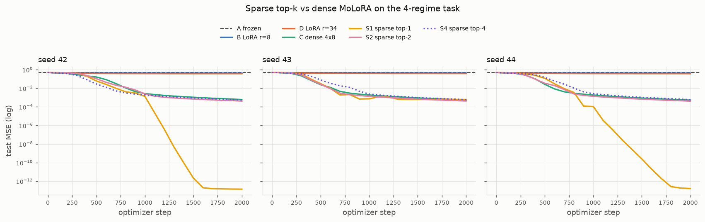
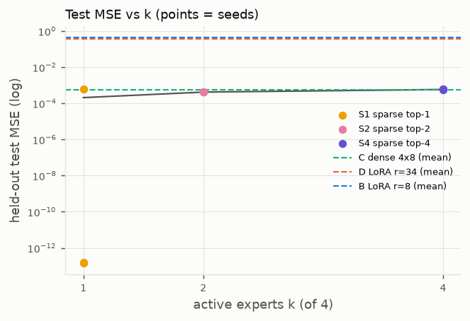
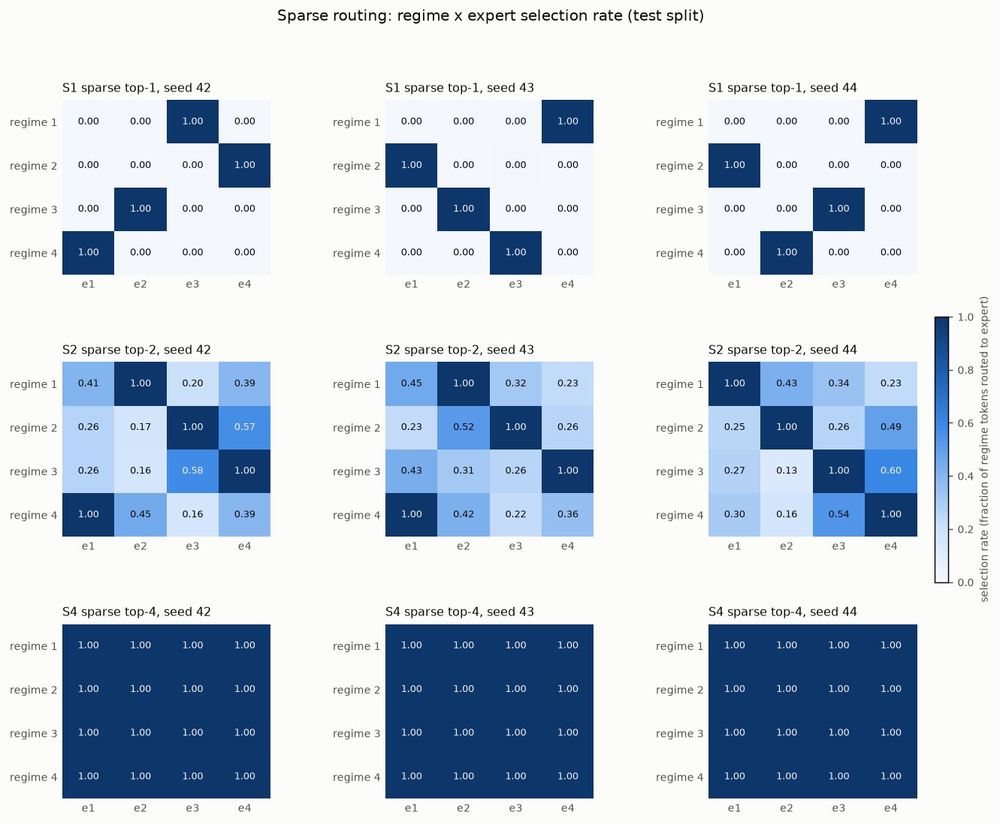
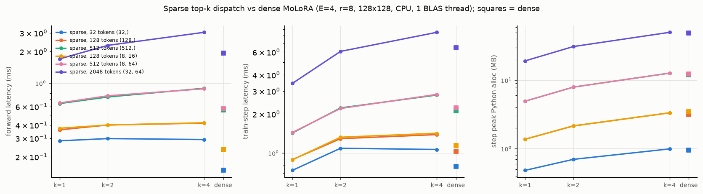

# Phase 3 validation report — sparse top-k Mixture-of-LoRA in Needle

Date: 2026-11-08. Branch `main`. CPU only (NumPy backend of the hw2 Needle); no
GPU figures exist and none are implied. Every number comes from the run
directories named below. Design and operator semantics:
[phase3_design.md](phase3_design.md).

## 1. Implementation summary

* `molora/ops/topk.py` — deterministic top-k selection (NumPy metadata) and
  renormalised sparse gates built from Needle ops; exact gradient with the
  selection fixed; `k = 1` weights are a constant (derivative 0); optional
  straight-through surrogate.
* `molora/sparse_router.py` — `SparseTopKRouter` (dense softmax → mask →
  renormalise; owns the router parameters).
* `molora/sparse_molora.py` — `SparseMoLoRALinear(DenseMoLoRALinear)` with
  `execution_mode="reference"` (all experts run, sparse weights applied) and
  `"dispatch"` (gather per expert, run only selected experts on their tokens,
  one multi-input scatter-add; inactive experts skipped); `last_stats`
  expert-work accounting; `routing_diagnostics`; `profile` timers;
  `load_balance_loss` (unused in experiments).
* `molora/ops/dispatch.py` — `GatherRows` / `ScatterAddRows` Needle
  `TensorOp`s, mutually adjoint, with a unique-index fast path.

## 2. Tests

Command: `python -m pytest`.

| File | Tests | Result |
|---|---|---|
| Phases 0–2 (unchanged) | 176 | 176 passed |
| `tests/test_topk.py` | 37 | 37 passed |
| `tests/test_sparse_router.py` | 17 | 17 passed |
| `tests/test_sparse_molora_forward.py` | 47 | 47 passed |
| `tests/test_sparse_molora_backward.py` | 17 | 17 passed |
| `tests/test_sparse_dispatch.py` | 44 | 44 passed |
| `tests/test_sparse_training.py` | 15 | 15 passed |
| **total** | **353** | **353 passed, 0 failed, 0 skipped** (0.8 s) |

Covered (all with independent NumPy oracles where a reference is needed):
top-k membership, order and exactly-k selection for 1–4-D inputs; deterministic
ties (lower index first; a zero router routes to experts 0..k-1); invalid `k`;
renormalised weights sum to one with zeros off the selection; `k = E` returns
the dense probabilities bit-for-bit; extreme logits (±1e4, ties at 700) finite;
finite differences through logits → softmax → top-k gates (float64, rtol 1e-6)
away from selection boundaries; zero gradient on unselected entries; `k = 1`
exact weights constant; straight-through value and surrogate gradient (analytic
softmax Jacobian check). Sparse layer: shapes for `(1,)`, `(5,)`, `(2,3)`,
`(2,3,4)` batch shapes; initial output = frozen backbone; NumPy oracle for
`(E,k) ∈ {(3,1),(4,2),(5,3),(4,4)}`, bias on/off, 2-D/3-D (rtol 1e-11);
`k = E` equals `DenseMoLoRALinear` (rtol 1e-13); `E = 1, k = 1` equals
`LoRALinear`; accounting 8192/516/8708; finite differences for every `A_i`,
`B_i`, `W_g`, `b_g`, `x` for `(E,k) ∈ {(3,2),(4,2),(4,3)}` (rtol 1e-6, atol
1e-7, boundary margin ≥ 0.03 enforced); closed-form check that each expert's
gradient comes only from the tokens that selected it; a never-selected expert
gets exactly zero (reference) / no gradient at all (dispatch); top-1 exact has
no router gradient while straight-through matches the analytic surrogate.
Dispatch: gather/scatter forward and backward with repeated indices,
adjointness, permutation round-trip, error handling, fast path vs `np.add.at`
with cross-input repeats; dispatch = reference for forward, all parameter
gradients and input gradient (rtol 1e-11) over `(E,k) ∈ {(4,1),(4,2),(4,3),
(4,4),(3,2)}` × bias × 3 batch shapes; identical Adam trajectories over 5 and
10 steps in both modes; `k = E` dispatch = dense; skipped expert accounting
(6 of 8 matmuls, FLOP fraction 0.5); training: backbone bit-identical over
Adam/SGD steps in both modes, experts and router move (top-2), top-1 exact
router never moves while straight-through moves, determinism.

### Reference-vs-dispatch equivalence (measured)
Float64, `E = 4`, `k = 2`, 6→4, rank 2, 10 tokens: max |Δ forward| 7.1e-15,
max |Δ gradient| over all 10 trainable tensors 9.1e-13, max |Δ input
gradient| 9.1e-13. Tolerances used in the tests: rtol 1e-12 forward, rtol 1e-11
gradients; 5-step Adam losses agree to rtol 1e-12.

## 3. Top-1 routing: the router-gradient problem and what was done

With renormalised weights and `k = 1`, `g̃ = 1` on the selected expert for
every input, so `∂L/∂W_g = 0` identically (tested). Exact top-1 therefore
trains the experts under a *frozen random* routing. Two options were
implemented: (a) the straight-through surrogate (`router_grad_mode=
"straight_through"`): forward uses `g̃`, backward treats the weight as the
dense probability `g_i` of the selected expert — an estimator, not a
derivative; (b) the Switch-style auxiliary balance loss, implemented and
tested but not used. The pilot below compared exact vs straight-through on
validation data; straight-through was selected and is reported as such.

## 4. Pilot (validation only, seed 42; `outputs/sparse_molora_synthetic_pilot/20261108-163043`)

| method | router-grad mode | lr 1e-3 | lr 3e-3 | lr 1e-2 | chosen |
|---|---|---|---|---|---|
| sparse_top1 | renormalized | 4.262e-01 | 4.279e-01 | 4.547e-01 |  |
| sparse_top1 | straight_through | 9.351e-02 | 1.529e-13 | 5.515e-03 | **0.003** |
| sparse_top2 | renormalized | 4.024e-03 | 3.892e-04 | 1.414e-02 | **0.003** |
| sparse_top4 | renormalized | 5.925e-03 | 5.439e-04 | 2.546e-02 | **0.003** |

Exact renormalised top-1 never improves on the single-LoRA level (0.43),
confirming the frozen-router analysis; straight-through top-1 at 3e-3 reaches
1.5e-13 (an exact fit: hard routing lets each expert learn its regime's
correction with weight exactly 1, with no soft-gate dilution). The chosen rates
(3e-3 for all sparse methods, straight-through for top-1) were written to
`configs/sparse_molora.yaml`, then the protocol was frozen. Criteria registered
before the test run: on every seed top-2 test MSE ≤ 2× dense and ≤ 0.1×
matched LoRA; top-4 ≤ 1.5× dense; measured adapter-FLOP fraction = k/E;
backbone bit-identical; finite; seed-42 rerun reproduces top-2 to rtol 1e-6.

## 5. Predictive performance (confirmatory run `outputs/sparse_molora_synthetic/20261108-164426`)

Task, splits, planted corrections, `W0`, batch size 32, 2000 Adam steps and
seeds 42–44 are identical to Phase 2 (`make_problem` is imported unchanged).
Sparse methods run in **dispatch** mode. Reproduce:
`python experiments/train_sparse_molora.py` (≈ 70 s).

### Held-out test MSE per seed

| seed | A frozen | B single LoRA r=8 | D matched LoRA r=34 | C dense MoLoRA 4×r=8 | S1 sparse top-1 (STE) | S2 sparse top-2 | S4 sparse top-4 |
|---|---|---|---|---|---|---|---|
| 42 | 4.787e-01 | 4.230e-01 | 3.664e-01 | 6.057e-04 | 1.399e-13 | 4.189e-04 | 5.461e-04 |
| 43 | 4.936e-01 | 4.331e-01 | 3.752e-01 | 5.521e-04 | 6.206e-04 | 4.243e-04 | 5.925e-04 |
| 44 | 4.780e-01 | 4.199e-01 | 3.664e-01 | 5.278e-04 | 1.645e-13 | 4.100e-04 | 6.040e-04 |

### Aggregate over 3 seeds (train MSE on 2048 training samples; val/test on 1024 held-out samples)

| method | trainable params | train MSE | val MSE | test MSE mean ± std | mean train time (s) |
|---|---|---|---|---|---|
| A frozen | 0 | 4.893e-01 | 4.856e-01 | 4.834e-01 ± 8.8e-03 | 0.0 |
| B single LoRA r=8 | 2048 | 4.253e-01 | 4.255e-01 | 4.253e-01 ± 6.9e-03 | 0.6 |
| D matched LoRA r=34 | 8704 | 3.632e-01 | 3.705e-01 | 3.693e-01 ± 5.1e-03 | 0.7 |
| C dense MoLoRA 4×r=8 | 8708 | 5.469e-04 | 5.578e-04 | 5.619e-04 ± 4.0e-05 | 2.5 |
| S1 sparse top-1 (STE) | 8708 | 1.393e-13 | 1.469e-13 | 2.069e-04 ± 3.6e-04 | 3.0 |
| S2 sparse top-2 | 8708 | 4.219e-04 | 4.221e-04 | 4.177e-04 ± 7.2e-06 | 3.3 |
| S4 sparse top-4 | 8708 | 5.676e-04 | 5.797e-04 | 5.809e-04 ± 3.1e-05 | 3.4 |

### Per-regime test MSE (seed-averaged)

| method | regime 1 | regime 2 | regime 3 | regime 4 |
|---|---|---|---|---|
| A frozen | 4.829e-01 | 4.703e-01 | 4.913e-01 | 4.890e-01 |
| B single LoRA r=8 | 4.254e-01 | 4.092e-01 | 4.295e-01 | 4.371e-01 |
| D matched LoRA r=34 | 3.645e-01 | 3.680e-01 | 3.718e-01 | 3.729e-01 |
| C dense MoLoRA 4×r=8 | 6.653e-04 | 5.827e-04 | 4.875e-04 | 5.119e-04 |
| S1 sparse top-1 (STE) | 1.361e-13 | 8.275e-04 | 1.658e-13 | 1.378e-13 |
| S2 sparse top-2 | 4.338e-04 | 3.933e-04 | 4.503e-04 | 3.936e-04 |
| S4 sparse top-4 | 6.071e-04 | 5.719e-04 | 5.567e-04 | 5.879e-04 |

Ratios per seed (42/43/44): top-2 / dense = 0.69 / 0.77 / 0.78;
top-2 / matched LoRA = 1.14e-03 / 1.13e-03 / 1.12e-03;
top-4 / dense = 0.90 / 1.07 / 1.14.
Repeat of seed 42 (top-2): 4.188706e-04 both runs (identical).

**Comparison against Phase 2.** Dense MoLoRA reproduces its Phase 2 level
(5.6e-4 vs 5.7e-4 there; different adapter-init seeding, same task). Sparse
top-2 is *better* than dense on every seed (0.69–0.78× its test MSE) with half
the expert FLOPs; sparse top-4 — the same function as dense computed through
the dispatch path — lands within 0.90–1.14× of dense (differences come from
the different adapter initialisation draw and float32 summation order, not
from the maths; the unit tests show the two paths agree to 1e-11 in float64).
Both single-adapter baselines stay at 0.37–0.43, as in Phase 2.

**Top-1 with straight-through.** Seeds 42 and 44 fit the task to 1.4e-13 /
1.6e-13 test MSE (hard routing + exact one-hot regime code = exactly realisable).
Seed 43 reaches 1.3e-13 on validation but 6.2e-4 on test: regime 2's selection
rate for its expert is 0.9961, i.e. one of the 256 regime-2 test tokens was
misrouted, and under hard routing a single misrouted token costs the full
regime error (≈ 0.48 / 1024 ≈ 4.7e-4 averaged over the split). Hard top-1
routing is therefore all-or-nothing per token; this brittleness is the price of
the exact fit, and the result depends on the straight-through surrogate, so it
is **not** directly comparable to the exact-gradient methods.

## 6. Routing statistics (test split)

Selection rate = fraction of a regime's tokens that routed to an expert (rows
regimes, columns experts). Utilisation = fraction of all tokens selecting the
expert (sums to k). Entropy is of the dense pre-selection probabilities
(uniform = 1.386 nats).

**S1 sparse top-1 (STE), seed 42** — entropy per regime ['0.97', '0.74', '0.77', '0.73']; utilisation ['0.25', '0.25', '0.25', '0.25']; expert update norms ['8.00', '8.12', '8.05', '8.02'] (planted ‖ΔW_z‖ = 8.0); mean pairwise relative expert distance 1.412

| selection rate | e1 | e2 | e3 | e4 |
|---|---|---|---|---|
| regime 1 | 0.00 | 0.00 | 1.00 | 0.00 |
| regime 2 | 0.00 | 0.00 | 0.00 | 1.00 |
| regime 3 | 0.00 | 1.00 | 0.00 | 0.00 |
| regime 4 | 1.00 | 0.00 | 0.00 | 0.00 |

**S1 sparse top-1 (STE), seed 43** — entropy per regime ['0.80', '0.84', '0.74', '0.90']; utilisation ['0.25', '0.25', '0.25', '0.25']; expert update norms ['7.92', '7.96', '8.00', '8.05'] (planted ‖ΔW_z‖ = 8.0); mean pairwise relative expert distance 1.414

| selection rate | e1 | e2 | e3 | e4 |
|---|---|---|---|---|
| regime 1 | 0.00 | 0.00 | 0.00 | 1.00 |
| regime 2 | 1.00 | 0.00 | 0.00 | 0.00 |
| regime 3 | 0.00 | 1.00 | 0.00 | 0.00 |
| regime 4 | 0.00 | 0.00 | 1.00 | 0.00 |

**S1 sparse top-1 (STE), seed 44** — entropy per regime ['1.07', '0.65', '0.66', '0.72']; utilisation ['0.25', '0.25', '0.25', '0.25']; expert update norms ['7.97', '7.94', '7.99', '7.98'] (planted ‖ΔW_z‖ = 8.0); mean pairwise relative expert distance 1.413

| selection rate | e1 | e2 | e3 | e4 |
|---|---|---|---|---|
| regime 1 | 0.00 | 0.00 | 0.00 | 1.00 |
| regime 2 | 1.00 | 0.00 | 0.00 | 0.00 |
| regime 3 | 0.00 | 0.00 | 1.00 | 0.00 |
| regime 4 | 0.00 | 1.00 | 0.00 | 0.00 |

**S2 sparse top-2, seed 42** — entropy per regime ['0.35', '0.35', '0.38', '0.33']; utilisation ['0.48', '0.45', '0.49', '0.59']; expert update norms ['8.23', '8.23', '8.37', '8.30'] (planted ‖ΔW_z‖ = 8.0); mean pairwise relative expert distance 1.414

| selection rate | e1 | e2 | e3 | e4 |
|---|---|---|---|---|
| regime 1 | 0.41 | 1.00 | 0.20 | 0.39 |
| regime 2 | 0.26 | 0.17 | 1.00 | 0.57 |
| regime 3 | 0.26 | 0.16 | 0.58 | 1.00 |
| regime 4 | 1.00 | 0.45 | 0.16 | 0.39 |

**S2 sparse top-2, seed 43** — entropy per regime ['0.37', '0.35', '0.32', '0.35']; utilisation ['0.53', '0.56', '0.45', '0.46']; expert update norms ['8.23', '8.24', '8.20', '8.14'] (planted ‖ΔW_z‖ = 8.0); mean pairwise relative expert distance 1.415

| selection rate | e1 | e2 | e3 | e4 |
|---|---|---|---|---|
| regime 1 | 0.45 | 1.00 | 0.32 | 0.23 |
| regime 2 | 0.23 | 0.52 | 1.00 | 0.26 |
| regime 3 | 0.43 | 0.31 | 0.26 | 1.00 |
| regime 4 | 1.00 | 0.42 | 0.22 | 0.36 |

**S2 sparse top-2, seed 44** — entropy per regime ['0.33', '0.33', '0.37', '0.36']; utilisation ['0.46', '0.43', '0.54', '0.58']; expert update norms ['8.17', '8.23', '8.21', '8.21'] (planted ‖ΔW_z‖ = 8.0); mean pairwise relative expert distance 1.414

| selection rate | e1 | e2 | e3 | e4 |
|---|---|---|---|---|
| regime 1 | 1.00 | 0.43 | 0.34 | 0.23 |
| regime 2 | 0.25 | 1.00 | 0.26 | 0.49 |
| regime 3 | 0.27 | 0.13 | 1.00 | 0.60 |
| regime 4 | 0.30 | 0.16 | 0.54 | 1.00 |

**S4 sparse top-4, seed 42** — entropy per regime ['0.26', '0.27', '0.25', '0.29']; utilisation ['1.00', '1.00', '1.00', '1.00']; expert update norms ['8.36', '8.47', '8.40', '8.41'] (planted ‖ΔW_z‖ = 8.0); mean pairwise relative expert distance 1.416

| selection rate | e1 | e2 | e3 | e4 |
|---|---|---|---|---|
| regime 1 | 1.00 | 1.00 | 1.00 | 1.00 |
| regime 2 | 1.00 | 1.00 | 1.00 | 1.00 |
| regime 3 | 1.00 | 1.00 | 1.00 | 1.00 |
| regime 4 | 1.00 | 1.00 | 1.00 | 1.00 |

**S4 sparse top-4, seed 43** — entropy per regime ['0.28', '0.27', '0.28', '0.26']; utilisation ['1.00', '1.00', '1.00', '1.00']; expert update norms ['8.43', '8.42', '8.43', '8.49'] (planted ‖ΔW_z‖ = 8.0); mean pairwise relative expert distance 1.418

| selection rate | e1 | e2 | e3 | e4 |
|---|---|---|---|---|
| regime 1 | 1.00 | 1.00 | 1.00 | 1.00 |
| regime 2 | 1.00 | 1.00 | 1.00 | 1.00 |
| regime 3 | 1.00 | 1.00 | 1.00 | 1.00 |
| regime 4 | 1.00 | 1.00 | 1.00 | 1.00 |

**S4 sparse top-4, seed 44** — entropy per regime ['0.28', '0.27', '0.26', '0.27']; utilisation ['1.00', '1.00', '1.00', '1.00']; expert update norms ['8.53', '8.44', '8.51', '8.50'] (planted ‖ΔW_z‖ = 8.0); mean pairwise relative expert distance 1.417

| selection rate | e1 | e2 | e3 | e4 |
|---|---|---|---|---|
| regime 1 | 1.00 | 1.00 | 1.00 | 1.00 |
| regime 2 | 1.00 | 1.00 | 1.00 | 1.00 |
| regime 3 | 1.00 | 1.00 | 1.00 | 1.00 |
| regime 4 | 1.00 | 1.00 | 1.00 | 1.00 |

* **Top-2** specialises exactly like dense: each regime routes to one dominant
  expert with selection rate 1.00 and mean renormalised weight 0.97–0.98; the
  second slot is spread over the remaining experts (0.13–0.63) and carries
  ≈ 0.02 weight. Utilisation is 0.43–0.59 per expert (balanced around the
  ideal 0.5). Expert update norms 8.1–8.4 vs planted 8.0.
* **Top-1** is a hard permutation of regimes to experts (selection rate 1.00
  on the diagonal, utilisation exactly 0.25 each) while its *dense*
  probabilities remain comparatively soft (entropy 0.65–1.07): the
  straight-through gradient only needs the argmax to be right.
* **Top-4** equals dense routing (every expert selected; entropy 0.26–0.27 as
  in Phase 2).
* No auxiliary balance loss was used; balance follows from the task's equal
  regimes. Expert identities are permutation-invariant (different assignment
  per seed).

## 7. Actual sparse execution (training-time accounting)

Summed over all 2000 training forwards per run (`execution` in `results.json`):

| method | seed | adapter FLOP fraction vs dense | k/E | expert matmuls executed / dense | mean experts skipped per forward |
|---|---|---|---|---|---|
| S1 sparse top-1 (STE) | 42 | 0.2500 | 0.25 | 16000 / 16000 | 0.000 |
| S1 sparse top-1 (STE) | 43 | 0.2500 | 0.25 | 16000 / 16000 | 0.000 |
| S1 sparse top-1 (STE) | 44 | 0.2500 | 0.25 | 15996 / 16000 | 0.001 |
| S2 sparse top-2 | 42 | 0.5000 | 0.50 | 16000 / 16000 | 0.000 |
| S2 sparse top-2 | 43 | 0.5000 | 0.50 | 16000 / 16000 | 0.000 |
| S2 sparse top-2 | 44 | 0.5000 | 0.50 | 16000 / 16000 | 0.000 |
| S4 sparse top-4 | 42 | 1.0000 | 1.00 | 16000 / 16000 | 0.000 |
| S4 sparse top-4 | 43 | 1.0000 | 1.00 | 16000 / 16000 | 0.000 |
| S4 sparse top-4 | 44 | 1.0000 | 1.00 | 16000 / 16000 | 0.000 |

Executed adapter FLOPs are exactly `k/E` of dense (0.25 / 0.50 / 1.00) because
every token selects exactly `k` experts. With four balanced regimes and batch
32, an expert almost never receives zero tokens, so whole-expert skipping is
rare in training (it is exercised and verified in the unit tests). The saving
comes from each expert processing only its `M_i` tokens, not from skipping
experts. This accounting covers the expert low-rank products only; backbone,
router, gather/scatter and the output add are excluded.

## 8. Scaling ablations (`--sweep`, same task, 3 seeds, test MSE)

| variant | trainable params | test MSE mean ± std | per-seed (42/43/44) | mean time (s) |
|---|---|---|---|---|
| E=8, top-1 (straight-through) | 17416 | 6.645e-03 ± 3.1e-03 | 8.004e-03 / 8.786e-03 / 3.143e-03 | 4.3 |
| E=8, top-2 (exact gradient) | 17416 | 3.133e-04 ± 1.4e-04 | 3.123e-04 / 1.783e-04 / 4.494e-04 | 4.7 |
| E=8, top-4 (exact gradient) | 17416 | 1.847e-03 ± 3.7e-04 | 2.220e-03 / 1.847e-03 / 1.474e-03 | 5.0 |
| E=8, top-8 (exact gradient) | 17416 | 1.220e-03 ± 2.3e-04 | 1.053e-03 / 1.476e-03 / 1.130e-03 | 5.4 |
| E=4 top-2, rank r4 | 4612 | 1.677e-01 ± 6.4e-04 | 1.683e-01 / 1.671e-01 / 1.676e-01 | 3.2 |
| E=4 top-2, rank r8 | 8708 | 4.370e-04 ± 4.4e-05 | 4.872e-04 / 4.199e-04 / 4.038e-04 | 3.2 |
| E=4 top-2, rank r16 | 16900 | 4.401e-04 ± 3.0e-05 | 4.344e-04 / 4.729e-04 / 4.131e-04 | 3.3 |

(`outputs/sparse_molora_synthetic_sweep_experts/20261108-164513`,
`outputs/sparse_molora_synthetic_sweep_rank/20261108-164614`.)

* **More experts than regimes (E = 8).** Top-1 (straight-through) degrades
  badly (3.1e-3–8.8e-3; utilisation 0.01–0.25 with several near-starved
  experts, i.e. collapse onto a subset): with 8 hard slots for 4 regimes the
  surrogate-trained router has no pressure towards a clean assignment. Top-4
  and top-8 (= dense with 8 experts) sit at 1–2e-3, worse than their E = 4
  counterparts, because regimes are split across experts and the soft weights
  of the extra experts leave a residual. Top-2 is the exception: E = 8 top-2
  (3.1e-4 ± 1.4e-4) is on average better than E = 4 top-2 (4.2e-4) but with
  20× the seed-to-seed spread, so the difference is not established with three
  seeds. Sparse k = 2 is the most robust setting at both expert counts.
* **Rank.** Rank 4 cannot represent a rank-8 correction (error floor ≈ 0.17,
  about half the frozen error, as expected for a rank-4 approximation of a
  random rank-8 matrix); rank 8 and 16 both solve the task (4.0e-4–4.9e-4)
  with no benefit from the extra rank at 2000 steps.
* **Observed instability (superseded run).** The first rank sweep
  (`…_sweep_rank/20261108-164325`) was executed before adapter-init seeding was
  made process-stable (it used Python's randomised `hash()`), so its
  initialisations are not reproducible; in that run top-2 converged to a poor
  optimum on one of three seeds at rank 8 (1.610e-01 / 3.872e-04 / 6.825e-04) and rank 16
  (7.530e-02 / 4.710e-04 / 4.151e-04). The reproducible rerun shows no such failure, but
  the earlier run is evidence that exact-gradient top-2 routing can settle in
  a bad assignment for some initialisations; a wider seed study is needed
  before claiming otherwise.

## 9. Runtime and memory (`outputs/benchmark_sparse_molora/20261108-165023`)

`python experiments/benchmark_sparse_molora.py` — 128 → 128, float32, **1 BLAS
thread** (pinned before NumPy import), 5 warm-up + 50 timed iterations, median
with inter-quartile range; ≈ 45 s total. "Backward" times `loss.backward()`
alone after an untimed forward; "step" is forward + backward + Adam. Peak
memory is the per-step peak Python/NumPy allocation (tracemalloc), i.e.
activations, gates and gradients; trainable-parameter memory is identical for
dense and sparse (8 708 × 4 B ≈ 35 KB) and is not what differs. The whole
process peaked at 2743 MB RSS (all models, tracemalloc overhead
included; not attributable per model).

### E = 4, r = 8: dense vs sparse dispatch (and the reference mode for k = 2)

| tokens (shape) | model | forward ms (IQR) | backward ms (IQR) | step ms (IQR) | train tokens/s | step peak alloc MB | expert matmuls |
|---|---|---|---|---|---|---|---|
| 32 (32,) | single_lora_r8 | 0.025 (0.025–0.026) | 0.118 (0.113–0.122) | 0.161 (0.158–0.232) | 198838 | 0.26 | — |
| 32 (32,) | matched_lora_r34 | 0.029 (0.028–0.029) | 0.087 (0.085–0.132) | 0.189 (0.186–0.270) | 169272 | 0.44 | — |
| 32 (32,) | dense_E4 | 0.149 (0.147–0.150) | 0.414 (0.407–0.427) | 0.786 (0.781–0.829) | 40735 | 0.95 | 8 |
| 32 (32,) | sparse_E4_k1 | 0.283 (0.279–0.287) | 0.242 (0.240–0.248) | 0.735 (0.729–0.741) | 43531 | 0.48 | 8 |
| 32 (32,) | sparse_E4_k2 | 0.298 (0.293–0.301) | 0.527 (0.520–0.541) | 1.087 (1.070–1.125) | 29430 | 0.70 | 8 |
| 32 (32,) | sparse_E4_k4 | 0.292 (0.288–0.296) | 0.514 (0.505–0.527) | 1.064 (1.053–1.138) | 30073 | 0.99 | 8 |
| 32 (32,) | sparse_E4_k2_reference | 0.208 (0.206–0.212) | 0.466 (0.459–0.486) | 0.920 (0.912–0.935) | 34779 | 0.96 | 8 |
| 128 (128,) | single_lora_r8 | 0.065 (0.064–0.065) | 0.226 (0.219–0.231) | 0.246 (0.243–0.250) | 520188 | 0.86 | — |
| 128 (128,) | matched_lora_r34 | 0.078 (0.077–0.078) | 0.141 (0.140–0.174) | 0.318 (0.315–0.323) | 402363 | 1.06 | — |
| 128 (128,) | dense_E4 | 0.235 (0.234–0.238) | 0.552 (0.534–0.565) | 1.027 (1.018–1.084) | 124578 | 3.16 | 8 |
| 128 (128,) | sparse_E4_k1 | 0.360 (0.358–0.365) | 0.284 (0.279–0.289) | 0.889 (0.877–0.903) | 143923 | 1.37 | 8 |
| 128 (128,) | sparse_E4_k2 | 0.401 (0.397–0.405) | 0.615 (0.604–0.646) | 1.289 (1.271–1.333) | 99277 | 2.14 | 8 |
| 128 (128,) | sparse_E4_k4 | 0.417 (0.412–0.421) | 0.679 (0.663–0.697) | 1.385 (1.359–1.589) | 92394 | 3.34 | 8 |
| 128 (128,) | sparse_E4_k2_reference | 0.675 (0.671–0.681) | 0.593 (0.585–0.620) | 1.195 (1.166–1.212) | 107151 | 3.19 | 8 |
| 512 (512,) | single_lora_r8 | 0.209 (0.209–0.211) | 0.623 (0.217–0.631) | 0.553 (0.548–1.345) | 926186 | 3.24 | — |
| 512 (512,) | matched_lora_r34 | 0.286 (0.286–0.290) | 0.367 (0.364–0.372) | 0.803 (0.800–0.806) | 637541 | 3.52 | — |
| 512 (512,) | dense_E4 | 0.556 (0.553–0.558) | 1.145 (1.137–1.153) | 2.117 (2.103–2.137) | 241877 | 12.05 | 8 |
| 512 (512,) | sparse_E4_k1 | 0.640 (0.637–0.644) | 0.450 (0.445–0.455) | 1.426 (1.416–1.443) | 359163 | 4.94 | 8 |
| 512 (512,) | sparse_E4_k2 | 0.739 (0.734–0.744) | 1.033 (1.024–1.046) | 2.224 (2.197–2.264) | 230184 | 7.93 | 8 |
| 512 (512,) | sparse_E4_k4 | 0.894 (0.890–0.898) | 1.393 (1.379–2.209) | 2.795 (2.763–2.820) | 183198 | 12.70 | 8 |
| 512 (512,) | sparse_E4_k2_reference | 0.674 (0.668–0.678) | 1.232 (1.215–1.655) | 2.351 (2.325–2.378) | 217802 | 12.15 | 8 |
| 128 (8, 16) | single_lora_r8 | 0.060 (0.059–0.060) | 0.129 (0.127–0.132) | 0.266 (0.263–0.269) | 482091 | 0.92 | — |
| 128 (8, 16) | matched_lora_r34 | 0.073 (0.073–0.073) | 0.174 (0.172–0.176) | 0.337 (0.334–0.341) | 379974 | 1.34 | — |
| 128 (8, 16) | dense_E4 | 0.236 (0.235–0.241) | 0.648 (0.621–0.668) | 1.143 (1.132–1.173) | 111985 | 3.45 | 8 |
| 128 (8, 16) | sparse_E4_k1 | 0.373 (0.369–0.376) | 0.293 (0.289–0.300) | 0.886 (0.883–0.894) | 144443 | 1.37 | 8 |
| 128 (8, 16) | sparse_E4_k2 | 0.401 (0.396–0.406) | 0.630 (0.619–0.655) | 1.323 (1.303–1.377) | 96782 | 2.15 | 8 |
| 128 (8, 16) | sparse_E4_k4 | 0.421 (0.415–0.424) | 0.666 (0.658–0.691) | 1.419 (1.381–1.452) | 90205 | 3.33 | 8 |
| 128 (8, 16) | sparse_E4_k2_reference | 0.315 (0.311–0.320) | 0.611 (0.595–0.635) | 1.215 (1.186–1.242) | 105387 | 3.20 | 8 |
| 512 (8, 64) | single_lora_r8 | 0.222 (0.221–0.224) | 0.225 (0.224–0.228) | 0.579 (0.575–0.585) | 884573 | 3.31 | — |
| 512 (8, 64) | matched_lora_r34 | 0.281 (0.281–0.285) | 0.377 (0.373–0.381) | 0.807 (0.802–0.813) | 634825 | 3.80 | — |
| 512 (8, 64) | dense_E4 | 0.573 (0.569–0.577) | 1.212 (1.200–1.222) | 2.222 (2.198–2.256) | 230395 | 12.34 | 8 |
| 512 (8, 64) | sparse_E4_k1 | 0.649 (0.644–0.653) | 0.452 (0.447–0.456) | 1.439 (1.434–1.447) | 355804 | 4.94 | 8 |
| 512 (8, 64) | sparse_E4_k2 | 0.759 (0.740–0.767) | 1.056 (1.044–1.071) | 2.202 (2.181–2.215) | 232477 | 7.93 | 8 |
| 512 (8, 64) | sparse_E4_k4 | 0.884 (0.881–0.888) | 1.371 (1.362–1.382) | 2.826 (2.815–2.851) | 181194 | 12.70 | 8 |
| 512 (8, 64) | sparse_E4_k2_reference | 0.677 (0.672–0.680) | 1.224 (1.207–1.240) | 2.389 (2.365–2.407) | 214323 | 12.15 | 8 |
| 2048 (32, 64) | single_lora_r8 | 0.838 (0.836–0.841) | 2.164 (2.093–2.187) | 1.813 (1.795–4.783) | 1129310 | 13.04 | — |
| 2048 (32, 64) | matched_lora_r34 | 1.056 (1.054–1.060) | 1.229 (1.220–1.244) | 2.641 (2.627–2.653) | 775435 | 14.49 | — |
| 2048 (32, 64) | dense_E4 | 1.934 (1.924–1.981) | 3.540 (3.511–3.567) | 6.498 (6.435–6.580) | 315167 | 48.72 | 8 |
| 2048 (32, 64) | sparse_E4_k1 | 1.700 (1.694–1.709) | 1.058 (1.049–1.069) | 3.436 (3.424–3.456) | 595964 | 19.21 | 8 |
| 2048 (32, 64) | sparse_E4_k2 | 2.284 (2.275–2.318) | 2.942 (2.905–2.952) | 6.062 (6.004–6.118) | 337867 | 31.08 | 8 |
| 2048 (32, 64) | sparse_E4_k4 | 3.037 (3.030–3.051) | 4.582 (4.537–4.641) | 8.498 (8.467–8.589) | 241010 | 50.17 | 8 |
| 2048 (32, 64) | sparse_E4_k2_reference | 2.411 (2.403–2.418) | 3.924 (3.892–3.956) | 7.260 (7.215–7.320) | 282100 | 47.99 | 8 |

### Forward-time breakdown of the sparse models (medians, ms; dispatch = gather + scatter-add)

| tokens | model | backbone | router | expert | dispatch | total | dispatch share |
|---|---|---|---|---|---|---|---|
| 32 | sparse_E4_k1 | 0.020 | 0.071 | 0.038 | 0.097 | 0.280 | 35% |
| 32 | sparse_E4_k2 | 0.021 | 0.087 | 0.040 | 0.095 | 0.295 | 32% |
| 32 | sparse_E4_k4 | 0.020 | 0.070 | 0.044 | 0.098 | 0.284 | 34% |
| 32 | sparse_E4_k2_reference | 0.020 | 0.083 | 0.095 | 0.000 | 0.205 | 0% |
| 512 | sparse_E4_k1 | 0.173 | 0.136 | 0.066 | 0.153 | 0.614 | 25% |
| 512 | sparse_E4_k2 | 0.174 | 0.178 | 0.096 | 0.201 | 0.752 | 27% |
| 512 | sparse_E4_k4 | 0.175 | 0.149 | 0.153 | 0.279 | 0.892 | 31% |
| 512 | sparse_E4_k2_reference | 0.171 | 0.166 | 0.303 | 0.000 | 0.656 | 0% |
| 512 | sparse_E4_k1 | 0.177 | 0.138 | 0.068 | 0.160 | 0.634 | 25% |
| 512 | sparse_E4_k2 | 0.176 | 0.171 | 0.093 | 0.189 | 0.728 | 26% |
| 512 | sparse_E4_k4 | 0.177 | 0.149 | 0.151 | 0.283 | 0.896 | 32% |
| 512 | sparse_E4_k2_reference | 0.175 | 0.169 | 0.305 | 0.000 | 0.666 | 0% |
| 2048 | sparse_E4_k1 | 0.647 | 0.376 | 0.152 | 0.338 | 1.696 | 20% |
| 2048 | sparse_E4_k2 | 0.654 | 0.470 | 0.394 | 0.533 | 2.316 | 23% |
| 2048 | sparse_E4_k4 | 0.655 | 0.405 | 0.754 | 0.800 | 2.988 | 27% |
| 2048 | sparse_E4_k2_reference | 0.656 | 0.472 | 1.250 | 0.000 | 2.416 | 0% |

### Scaling rows (E = 8; ranks 4/16), 512 and 2048 tokens

| tokens | model | forward ms | step ms | step peak alloc MB |
|---|---|---|---|---|
| 512 | sparse_E8_k1 | 0.827 | 1.945 | 5.10 |
| 512 | sparse_E8_k2 | 0.961 | 3.011 | 8.53 |
| 512 | sparse_E8_k4 | 1.165 | 3.752 | 13.41 |
| 512 | sparse_E8_k8 | 1.481 | 5.047 | 23.01 |
| 512 | dense_E8 | 0.881 | 3.813 | 22.12 |
| 512 | sparse_E4_k2_r4 | 0.730 | 2.116 | 7.83 |
| 512 | sparse_E4_k2_r16 | 0.773 | 2.375 | 8.15 |
| 512 | dense_E4_r4 | 0.515 | 1.994 | 11.92 |
| 512 | dense_E4_r16 | 0.673 | 2.496 | 12.33 |
| 2048 | sparse_E8_k1 | 2.159 | 4.319 | 19.37 |
| 2048 | sparse_E8_k2 | 2.669 | 7.209 | 32.95 |
| 2048 | sparse_E8_k4 | 3.758 | 10.515 | 52.41 |
| 2048 | sparse_E8_k8 | 5.827 | 16.036 | 90.85 |
| 2048 | dense_E8 | 3.737 | 11.661 | 89.55 |
| 2048 | sparse_E4_k2_r4 | 2.076 | 5.572 | 30.88 |
| 2048 | sparse_E4_k2_r16 | 2.492 | 6.432 | 31.50 |
| 2048 | dense_E4_r4 | 1.725 | 6.007 | 47.87 |
| 2048 | dense_E4_r16 | 2.162 | 7.460 | 50.45 |

### Is sparse execution actually faster? (measured wall clock, this CPU)

| tokens | k=1 step / dense step | k=2 step / dense step | k=4 step / dense step | k=1 fwd / dense fwd | k=2 fwd / dense fwd | k=1 peak alloc / dense | k=2 peak alloc / dense |
|---|---|---|---|---|---|---|---|
| 32 | 0.94 | 1.38 | 1.35 | 1.91 | 2.00 | 0.51 | 0.73 |
| 128 | 0.78 | 1.16 | 1.24 | 1.58 | 1.70 | 0.40 | 0.62 |
| 512 | 0.65 | 0.99 | 1.27 | 1.13 | 1.32 | 0.40 | 0.64 |
| 2048 | 0.53 | 0.93 | 1.31 | 0.88 | 1.18 | 0.39 | 0.64 |

* **FLOPs vs wall clock.** Adapter FLOPs are exactly k/E of dense in every
  configuration, but wall-clock savings appear only where the expert work is
  large enough to outweigh dispatch. The dispatch share of the sparse forward is
  32% at 32 tokens and 23% at 2048 tokens (k = 2); the expert products
  themselves take only 0.09 ms of the 0.73 ms sparse forward at 512 tokens.
* **Forward latency.** Sparse dispatch is slower than dense at ≤ 512 tokens for
  every k (1.9× at 32 tokens for k = 1); it becomes faster only for k = 1 at
  2048 tokens (0.88×). Dense MoLoRA's forward is cheap because its per-expert
  work is a handful of BLAS calls with no data movement.
* **Training step.** Backward and optimizer dominate the step, and here sparse
  wins earlier: k = 1 is 1.07× faster than dense at 32 tokens, 1.54× at 512 and
  1.89× at 2048 tokens; k = 2 breaks even at 512 tokens (0.99×) and is 1.07× faster
  at 2048; k = 4 (same work as dense plus dispatch) is 1.27–1.35× slower.
* **Memory.** Per-step peak allocation scales with k: k = 1 uses 40% and
  k = 2 64% of dense at 512 tokens (4.9 / 7.9 vs 12.3 MB), consistently
  across sizes, because expert activations and their gradients exist only for
  the k·N selected rows. k = 4 is ≈ dense plus the gate/index buffers.
* **E = 8.** With more experts the dense cost grows linearly while sparse
  cost grows with k: at 512 tokens k = 1 / k = 2 steps are 1.94 / 3.01 ms vs
  3.81 ms dense, and peak allocation 5.1 / 8.5 vs 22.1 MB.
  Sparsity pays off more as E grows.
* **Reference mode** (all experts run, sparse weights applied) has a *faster
  forward* than dispatch at ≤ 512 tokens and dense-level memory: at these
  sizes the expert FLOPs it wastes cost less than the gathers it avoids.
* **Verdict (outcome 3 of Task 3B.7).** On this CPU/NumPy stack sparse
  routing always reduces adapter FLOPs and per-step memory, but reduces
  wall-clock time only for small k and ≳ 512 tokens (training step) or
  ≳ 2048 tokens (forward); at small workloads dispatch overhead makes it
  slower than dense. The dispatch cost is dominated by Python-level op
  overhead and NumPy gather/scatter, not by arithmetic; a fused kernel would
  move the break-even point but was out of scope. Nothing here says anything
  about GPU behaviour.

## 10. Known limitations

* Single synthetic layer with an explicit one-hot regime code; exactly
  realisable, noise-free; three seeds; no significance tests.
* Top-1 results rely on the straight-through surrogate; exact top-1 cannot
  train its router. Hard routing is brittle per token (one misrouted test
  token in seed 43 cost 6.2e-4 MSE).
* One non-reproducibly seeded run showed top-2 converging to a poor optimum
  on 2 of 9 runs; the reproducible runs did not, but the phenomenon is real
  and unquantified.
* No capacity factor or token dropping; no auxiliary balance loss in any
  experiment; E = 8 top-1 shows expert starvation.
* Gather/scatter are NumPy kernels; the dense `(N, E)` gate matrix is always
  materialised; per-expert Python op overhead (~10 ops per active expert)
  dominates small batches. CPU-only numbers; absolute times reflect Needle's
  Python op graph.
* Peak memory is Python/NumPy allocation per step, not process RSS and not
  GPU memory.

## 11. Readiness for Phase 4 and outstanding items

Phase 3 goals are met: correct and verified sparse routing in two equivalent
execution modes, genuine expert skipping, exact k/E FLOP accounting, and a
measured (not assumed) efficiency picture. Outstanding before Phase 4
(quantised frozen backbone): (i) decide whether a batched/fused expert path is
worth building to move the CPU break-even point; (ii) a wider seed study of
top-2 convergence failures and of top-1 STE brittleness, possibly with the
implemented balance loss as an ablation; (iii) an evaluation on a task where
the regime is not an explicit input feature; (iv) if GPU numbers are ever
wanted, the hw3 NDArray backend would need Needle's autograd/ops completed
and CUDA gather/scatter kernels — none of the CPU timings transfer.
