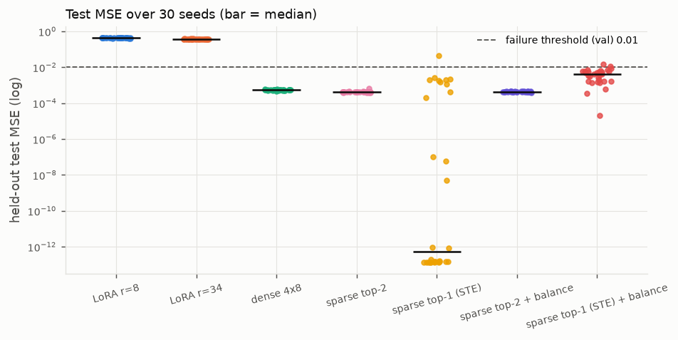
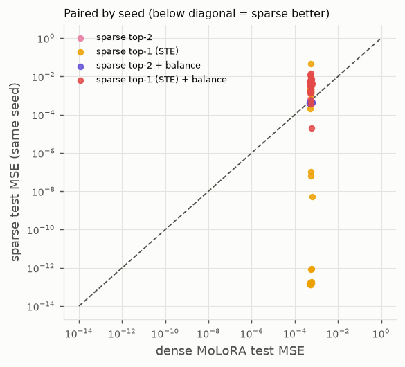
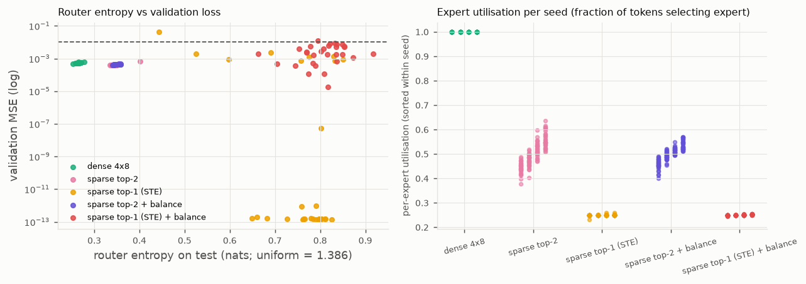
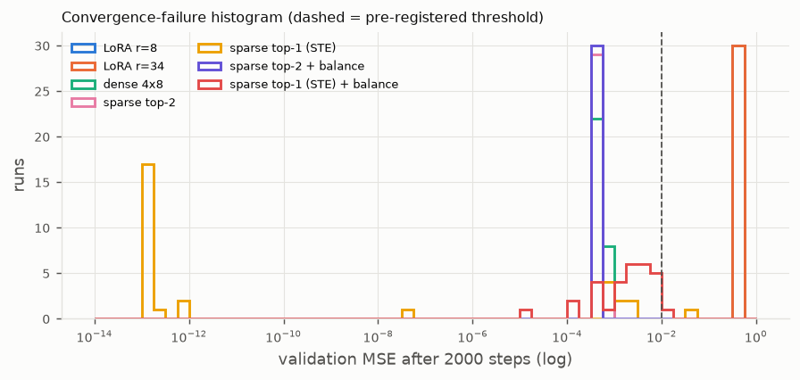

# Phase 4A — statistical robustness of sparse routing (30 seeds)

Date: 2026-11-08. Branch `main`. CPU only. Run directories:
study `outputs/phase4a_robustness/20261108-171345`, balance pilot
`outputs/phase4a_robustness_pilot_balance/20261108-170829`, balance ablation
`outputs/phase4a_robustness_balance_ablation/20261108-171013`
(`runs.jsonl` holds every run; `analysis.json` the statistics and failure
diagnostics; `summary.md` the tables below).

## 1. Question

How often does sparse top-2 routing converge to a poor solution, and how does
that compare with dense routing and top-1 straight-through routing? Phase 3
had seen top-2 settle in a poor optimum on 2 of 9 runs under a
non-reproducibly seeded script, but not in the reproducible rerun.

## 2. Frozen protocol (`configs/phase4_robustness.yaml`, `experiments/robustness_study.py`)

* **Task, splits, planted corrections, frozen `W0`**: the Phase 2/3
  `make_problem()` unchanged (4 one-hot-coded regimes, rank-8 corrections at
  half the backbone norm, 8192/1024/1024 samples). Within a seed every method
  shares data, `W0` and minibatch order.
* **Randomness sources**, all derived from the study seed `s` with
  `molora.protocol.derive_seed` (crc32-based, process-stable; a test asserts no
  `hash()` call exists in `molora/` or `experiments/`): data + backbone
  (`make_problem(cfg, s)`), expert + router initialisation
  (`derive_seed(s, "init")`, identical for dense / top-2 / top-1 — **paired
  initialisation**, verified by `test_paired_initialisation_across_moe_methods`
  and `test_study_builder_shares_data_backbone_and_pairs_init`), minibatch order
  (`derive_seed(s, "shuffle")`). Needle's Adam is deterministic.
* **Initialisation policy** (unchanged from Phase 3, fixed before the run):
  `A_i` Kaiming-uniform, `B_i = 0`, router Xavier-uniform, bias 0, `T = 1`.
* **Seeds** 1000–1029 (30), disjoint from Phase 3's 42–44. 2000 Adam steps,
  batch 32, MSE, learning rates from the Phase 3 protocol (1e-3 LoRA, 3e-3 MoE).
* **Methods**: LoRA r=8 (2 048 params), LoRA r=34 (8 704), dense 4×r=8
  (8 708), sparse top-2 exact-gradient (8 708, dispatch mode), sparse top-1
  straight-through (8 708).
* **Failure criterion, pre-registered**: validation MSE > 0.01 after 2000
  steps. Rationale: 0.01 is about 2 % of the frozen error (0.48) and about 20×
  the 4e-4 to 6e-4 every converged Phase 3 MoE run reached, so it separates
  "learned the routing" from "stuck" without being fit to new outcomes. Test
  labels are never used to classify. The criterion presupposes routing
  capacity: single-adapter baselines cannot pass it (their floor is 0.37–0.43)
  and are reported as 30/30 "failures" for completeness only.

## 3. Results

### Held-out test MSE and validation-defined failures (n = 30 each)

| method | params | mean | median | std | IQR (q1–q3) | min | max | failures | failure rate [exact 95 % CI] |
|---|---|---|---|---|---|---|---|---|---|
| LoRA r=8 | 2 048 | 4.297e-01 | 4.289e-01 | 8.3e-03 | 4.25e-01–4.35e-01 | 4.14e-01 | 4.47e-01 | 30/30 | 1.000 [0.884, 1.000] |
| LoRA r=34 | 8 704 | 3.732e-01 | 3.721e-01 | 6.9e-03 | 3.70e-01–3.77e-01 | 3.60e-01 | 3.88e-01 | 30/30 | 1.000 [0.884, 1.000] |
| dense 4×8 | 8 708 | 5.457e-04 | 5.492e-04 | 2.6e-05 | 5.30e-04–5.56e-04 | 4.80e-04 | 6.18e-04 | **0/30** | 0.000 [0.000, 0.116] |
| sparse top-2 | 8 708 | 4.263e-04 | 4.227e-04 | 4.2e-05 | 4.08e-04–4.31e-04 | 3.87e-04 | 6.35e-04 | **0/30** | 0.000 [0.000, 0.116] |
| sparse top-1 (STE) | 8 708 | 2.000e-03 | 5.2e-13 | 8.3e-03 | 1.4e-13–9.72e-04 | 1.3e-13 | 4.59e-02 | **1/30** | 0.033 [0.001, 0.172] |

Every run kept `W0` bit-identical and all values finite.

### Paired comparison with dense (same seed ⇒ same data, backbone, initial parameters, minibatches)

| method | mean Δ test MSE (method − dense) [95 % paired bootstrap CI, 10 000 resamples] | median Δ [CI] | mean log10 ratio [CI] | seeds better than dense |
|---|---|---|---|---|
| sparse top-2 | −1.19e-04 [−1.34e-04, −1.00e-04] | −1.24e-04 [−1.34e-04, −1.10e-04] | −0.108 [−0.121, −0.092] | 29/30 (0.967) |
| sparse top-1 (STE) | +1.45e-03 [−2.9e-04, +4.6e-03] | −5.25e-04 [−5.50e-04, −3.99e-04] | −5.62 [−7.22, −3.96] | 22/30 (0.733) |
| LoRA r=34 | +3.73e-01 [+3.70e-01, +3.75e-01] | | +2.835 | 0/30 |




### Routing (test split, final)

| method | mean router entropy (nats; uniform 1.386) | distinct dominant experts | mean min / max utilisation |
|---|---|---|---|
| dense 4×8 | 0.265 | 4 on 30/30 seeds | 1.00 / 1.00 |
| sparse top-2 | 0.350 | 4 on 30/30 | 0.44 / 0.56 |
| sparse top-1 (STE) | 0.749 | 4 on 30/30 | 0.25 / 0.25 |




## 4. Interpretation

* **Sparse top-2 did not fail on any of 30 seeds** (exact 95 % CI for the
  failure rate 0–11.6 %). Its test MSE is tightly distributed (3.9e-4 to
  6.4e-4) and lower than dense on 29 of 30 paired seeds; the paired mean
  difference of −1.2e-4 (≈ 22 % lower, log10 ratio −0.108) has a bootstrap CI
  well away from zero. With 30 paired runs this is a robust, if small, effect
  on this task. The Phase 3 convergence failures were therefore an artefact
  of the specific (non-reproducible) initialisations, not a frequent mode:
  with the frozen initialisation policy the failure rate is below ~12 % at 95 %
  confidence, and the point estimate is 0.
* **Dense never failed** either; its spread is the smallest (std 2.6e-5).
* **Top-1 straight-through is bimodal.** 20 of 30 seeds reach the exact
  solution (test ≈ 1.4e-13), 9 have 1–6 misrouted test tokens out of 1024
  (test 1e-4 to 2e-3, each misrouted token costing the full regime error), and
  1 seed failed the validation criterion. The median difference to dense is
  strongly negative, but the mean difference is positive with a CI that
  includes zero; whether top-1 is "better" depends entirely on the statistic
  chosen, which is itself the finding: hard routing trades a bimodal risk for
  an exact fit. Its router entropy stays high (0.75) because the surrogate
  only needs the argmax to be right.
* **Initialisation sensitivity.** With the Xavier router, 27 of 30 seeds start
  with an initial dominant-expert *collision* (two regimes prefer the same
  expert on the validation set). Dense and top-2 resolved every collision; top-1
  resolved 29 of 30 within 2000 steps. Collisions at initialisation are the
  norm, not the exception, and are not by themselves predictive of failure.

## 5. Failure diagnostics (hypotheses tested on the failed runs)

**sparse top-1 (STE), seed 1011** (val 4.34e-2, test 4.59e-2; per-regime test
1.42e-1 / 2.5e-3 / 4.0e-3 / 3.5e-2).

* Trajectory: validation MSE fell to 0.20 by step 800 and plateaued at
  0.20–0.22 until step 1800, then dropped to 0.126 (1900) and 0.043 (2000) —
  still descending when the budget ended.
* Routing: initial dominant experts [1, 2, 0, 1] (regimes 1 and 4 collide);
  final [2, 0, 3, 1] — four distinct, but regime 1's expert receives only
  92.6 % of its tokens (3.5 % / 3.5 % / 0.4 % go elsewhere), so regime 1 is
  the un-finished reassignment. Utilisation stayed 0.23–0.26 throughout
  (no **starvation**), entropy 0.44 (no **collapse** to uniform), train loss
  still decreasing (no **optimizer instability**: no spikes, finite, Adam at
  3e-3 as elsewhere). Router gradient norm remained 0.1–0.2 from step 700 to
  1900 (vs ≈ 1e-8 for converged top-1 runs by step 2000): the router was
  actively re-assigning for 1200 steps.
* Conclusion: **slow symmetry breaking after an initial collision**, i.e. a
  late poor-assignment phase, not expert starvation, routing collapse or
  optimizer instability. More steps would very likely have completed it; the
  "failure" is a budget failure under hard routing.

**sparse top-1 (STE) + balance 0.01, seed 1004** (val 1.20e-2, test 1.44e-2).

* Trajectory: validation reached 3.3e-4 at step 800, then *drifted upward*
  (8e-4 … 5e-3 … 1.2e-2 at step 2000) while the router gradient norm jumped at
  step 2000 (7e-2) with expert 4's gradient at 8e-2 — the balance term and
  the task gradient fighting over boundary tokens (selection rates 0.988–0.996
  instead of 1.0; final dense probabilities 0.72–0.76 on the dominant expert).
* Conclusion: with hard routing the balance loss keeps the dense probabilities
  soft, so argmax flips near regime boundaries recur; this is a genuine
  **instability induced by the auxiliary loss**, not an initialisation effect.

## 6. Balance-loss ablation (Switch-style `E Σ f_i P_i`)

**Pilot (validation only, seeds 2000–2004, disjoint from the study):** top-2
with coefficient 0.01 / 0.1 / 1.0 gave median validation MSE 4.26e-4 /
5.99e-4 / 5.26e-3 with 0 failures each; unbalanced top-2 on the same seeds
4.21e-4. Rule fixed in advance: fewest validation failures, then lowest
median → **0.01**, then applied to top-2 and top-1 on the 30 study seeds.

| method | mean test MSE | median | std | min | max | failures | seeds better than dense | mean min / max utilisation |
|---|---|---|---|---|---|---|---|---|
| sparse top-2 | 4.263e-04 | 4.227e-04 | 4.2e-05 | 3.87e-04 | 6.35e-04 | 0/30 | 29/30 | 0.44 / 0.56 |
| sparse top-2 + balance 0.01 | 4.310e-04 | 4.287e-04 | 1.7e-05 | 3.91e-04 | 4.72e-04 | 0/30 | 30/30 | 0.46 / 0.54 |
| sparse top-1 (STE) | 2.000e-03 | 5.2e-13 | 8.3e-03 | 1.3e-13 | 4.59e-02 | 1/30 | 22/30 | 0.25 / 0.25 |
| sparse top-1 (STE) + balance 0.01 | 4.464e-03 | 4.078e-03 | 3.3e-03 | 2.0e-05 | 1.44e-02 | 1/30 | 2/30 | 0.25 / 0.25 |

* For **top-2** the balance loss changes nothing that matters: same 0/30
  failure rate, mean +5e-6 (within noise), a somewhat tighter spread (std
  1.7e-5 vs 4.2e-5, max 4.7e-4 vs 6.4e-4) and utilisation pulled from
  0.44–0.56 to 0.46–0.54. On a task with equal regimes there is no imbalance
  to fix.
* For **top-1** it is harmful: every one of the 30 runs now has misrouted
  test tokens (test 2e-5 to 1.4e-2, median 4.1e-3; unbalanced top-1 median
  5e-13), the failure count is unchanged (1/30) and only 2 seeds beat dense.
  Keeping the dense probabilities balanced (entropy 0.81 vs 0.75) softens the
  argmax margins that hard routing depends on.

## 7. Limitations

Single-layer synthetic task with an explicit regime code; one initialisation
policy (Xavier router, zero-B) — the Phase 3 failures came from a different,
unreproducible draw, so other policies could behave differently; 30 seeds
bound the failure rate only to < 12 %; the failure threshold is operational,
and the continuous distributions above should be read alongside it; one
balance coefficient; all conclusions are about this task.

## 8. Deliverables

`experiments/robustness_study.py` (pilot-balance / study / ablation / analyze,
resume-safe JSONL), `configs/phase4_robustness.yaml`,
`molora/protocol.py` (derive_seed, failure criterion, exact binomial CI,
paired bootstrap, summaries), `tests/test_robustness_protocol.py` (7 tests),
`SparseMoLoRALinear.forward_with_selection` (so the balance loss can see the
selection), figures under `docs/figures/phase4a_*`.

Reproduce (≈ 5 min study + 3.5 min ablation + 1 min pilot on this host):

```bash
python experiments/robustness_study.py pilot-balance
python experiments/robustness_study.py study
python experiments/robustness_study.py ablation
python experiments/robustness_study.py analyze outputs/phase4a_robustness/<ts> --ablation-dir outputs/phase4a_robustness_balance_ablation/<ts>
```
