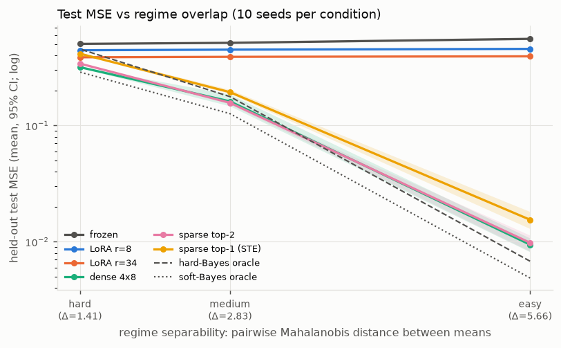
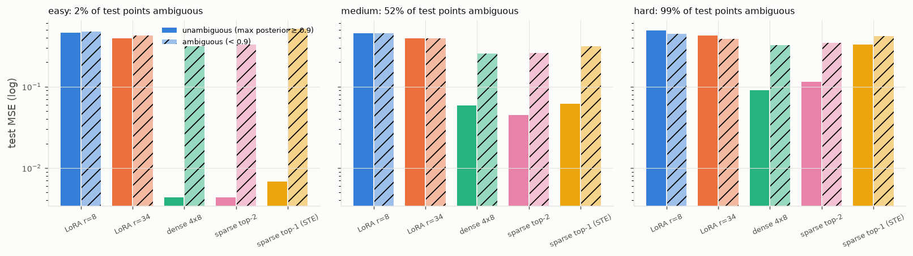
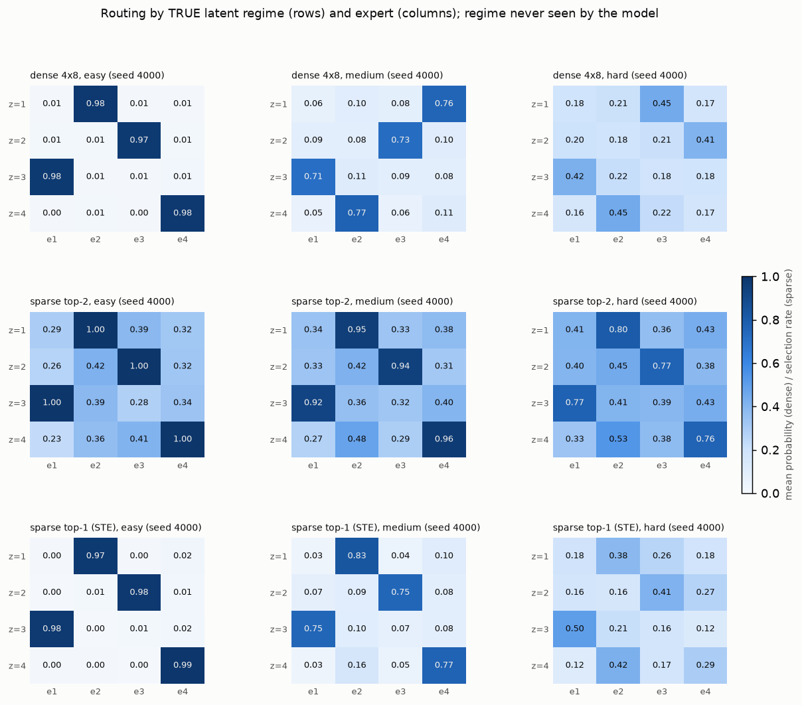

# Phase 4B — implicit regime discovery (latent-regime benchmark)

Date: 2026-11-08. Branch `main`. CPU only. Run directories: pilot
`outputs/phase4b_latent_regime_pilot/20261108-172448`, confirmatory
`outputs/phase4b_latent_regime/20261108-173101` (`runs.jsonl`,
`problems.jsonl` with per-problem identifiability and oracles, `analysis.json`,
`summary.md`, figures).

## 1. Question

Can sparse MoLoRA learn input-dependent expert specialisation when the regime
is represented only through the input distribution — no one-hot indicator, no
regime id anywhere in the model's inputs?

## 2. Dataset (`experiments/latent_regime_dataset.py`, tested by `tests/test_latent_regime_dataset.py`)

```
z ~ Uniform{1..4}                                   (hidden)
x | z ~ N(mu_z, I_128),   mu_z = delta * u_z,  u_1..u_4 orthonormal random directions
y = x (W0 + dW_z),        dW_z rank 8, ||dW_z||_F = 0.5 ||W0||_F,  W0 = frozen nn.Linear(128,128) init
```

The model sees `x` (and `y` for the loss) only; `z` is kept by the generator
for diagnostics. Train / validation / test (8192 / 1024 / 1024) are independent
draws from the same distribution; the tests check balanced regimes, no shared
rows across splits, unit within-regime variance in every coordinate (no
deterministic code), planted ranks and norms, and seeding (same seed ⇒ same
`W0`, `dW_z`, data; same seed with a different `delta` ⇒ same `W0`/`dW_z`,
different inputs).

**Separability conditions, fixed before any model ran**, defined by the
pairwise Mahalanobis distance between regime means `Δ = delta·√2` (σ = 1):

| condition | delta | Δ | Bayes-optimal regime accuracy (test, true params) | nearest-centroid accuracy (fit on train labels) | mean max posterior | fraction "ambiguous" (max posterior < 0.9) |
|---|---|---|---|---|---|---|
| easy | 4.0 | 5.66 | 0.994 | 0.993 | 0.992 | 0.017 |
| medium | 2.0 | 2.83 | 0.825 | 0.822 | 0.821 | 0.523 |
| hard | 1.0 | 1.41 | 0.549 | 0.537 | 0.551 | 0.985 |

(chance = 0.25; averages over the 10 confirmatory seeds). Identifiability is
measured with the true posterior and with a data-driven classifier,
independently of any adapter model.

**Oracles** (diagnostic lower bounds, *not* fair baselines; they use the
planted corrections and perfect experts): true-regime oracle `x(W0+dW_z)`
(= 0, noise-free); hard-Bayes oracle `dW_{argmax p(z|x)}`; soft-Bayes oracle
`Σ_z p(z|x) dW_z` — the best any `x`-only router can do.

## 3. Protocol

* Methods (all share `W0`, data, minibatch order per seed; MoE methods share
  initial parameters): frozen, LoRA r=8 (2 048), LoRA r=34 (8 704), dense 4×8
  (8 708), **sparse top-2 exact gradient** (the primary sparse configuration,
  chosen from Phase 4A: 0/30 failures, better than dense on 29/30), sparse
  top-1 straight-through (brittleness comparison). 4 experts, rank 8, Xavier
  router, zero-`B` init, dispatch mode.
* 2000 Adam steps, batch 32, MSE. Learning rates from a **validation-only
  pilot** on seeds 3000–3001 across all three conditions (geometric-mean
  validation MSE; candidates 1e-3 / 3e-3): LoRA 1e-3, dense 3e-3, top-2 3e-3,
  top-1 1e-3. Frozen before the confirmatory run.
* Confirmatory seeds 4000–4009 (10 per condition), test split used once.
* Pre-registered failure criterion: validation MSE > max(0.01, 2 × soft-Bayes
  oracle validation MSE).
* "Ambiguous" test points: max true posterior < 0.9 (fixed in the config).

## 4. Results (held-out test MSE, 10 seeds per condition; mean [95 % bootstrap CI])

| condition | frozen | LoRA r=8 | LoRA r=34 | dense 4×8 | sparse top-2 | sparse top-1 (STE) | hard-Bayes oracle | soft-Bayes oracle |
|---|---|---|---|---|---|---|---|---|
| easy | 0.558 | 0.457 | 0.395 | 9.44e-3 [8.2e-3, 1.07e-2] | 9.79e-3 [8.3e-3, 1.14e-2] | 1.55e-2 [1.29e-2, 1.81e-2] | 6.80e-3 | 4.87e-3 |
| medium | 0.516 | 0.451 | 0.391 | 0.162 [0.147, 0.186] | 0.157 [0.153, 0.161] | 0.194 [0.188, 0.204] | 0.178 | 0.127 |
| hard | 0.505 | 0.445 | 0.387 | 0.318 [0.315, 0.322] | 0.342 [0.338, 0.345] | 0.416 [0.409, 0.423] | 0.456 | 0.289 |

Paired differences to dense (same seed), mean [95 % paired bootstrap CI], and
fraction of seeds on which the method beats dense:

| condition | sparse top-2 − dense | top-2 better | sparse top-1 − dense | top-1 better |
|---|---|---|---|---|
| easy | +3.5e-4 [+2.9e-5, +6.9e-4] | 3/10 | +6.0e-3 [+3.8e-3, +8.7e-3] | 0/10 |
| medium | −4.5e-3 [−2.8e-2, +7.8e-3] | 1/10 | +3.2e-2 [+5.1e-3, +5.2e-2] | 1/10 |
| hard | +2.35e-2 [+2.20e-2, +2.49e-2] | 0/10 | +9.8e-2 [+9.3e-2, +1.03e-1] | 0/10 |



Per-regime test MSE is flat across regimes for every method in every
condition (`analysis.json`), i.e. no regime is neglected.

### Ambiguous vs unambiguous test points (seed-averaged MSE)

| condition (ambiguous fraction) | method | unambiguous | ambiguous |
|---|---|---|---|
| easy (1.7 %) | dense / top-2 / top-1 | 4.3e-3 / 4.3e-3 / 6.8e-3 | 0.31 / 0.33 / 0.52 |
| medium (52 %) | dense / top-2 / top-1 | 5.9e-2 / 4.5e-2 / 6.1e-2 | 0.26 / 0.26 / 0.32 |
| hard (98.5 %) | dense / top-2 / top-1 | 9.0e-2 / 0.115 / 0.33 | 0.32 / 0.35 / 0.42 |



### Routing diagnostics (test split)

Routing purity = fraction of tokens routed (argmax) to their regime's majority
expert; "router = Bayes" = agreement between the router's argmax and the
Bayes-optimal regime decision after matching experts to regimes.

| condition | method | purity | router = Bayes | entropy (nats; uniform 1.386) | utilisation (sorted, mean) | failures (pre-registered) |
|---|---|---|---|---|---|---|
| easy | dense / top-2 / top-1 | 0.990 / 0.990 / 0.987 | 0.993 / 0.993 / 0.988 | 0.05 / 0.05 / 0.16 | 1.0 ×4 / 0.47–0.53 / 0.25 ×4 | 1/10 / 2/10 / 9/10 |
| medium | dense / top-2 / top-1 | 0.808 / 0.806 / 0.805 | 0.893 / 0.914 / 0.912 | 0.43 / 0.40 / 0.55 | — / 0.47–0.52 / 0.24–0.26 | 0 / 0 / 0 |
| hard | dense / top-2 / top-1 | 0.526 / 0.519 / 0.448 | 0.819 / 0.790 / 0.577 | 0.94 / 0.76 / 0.82 | — / 0.47–0.53 / 0.22–0.28 | 0 / 0 / 0 |



## 5. Interpretation

1. **Routing is learned without any regime feature.** In every condition the
   router's purity matches the Bayes-optimal identification accuracy
   (0.99 vs 0.994, 0.81 vs 0.825, 0.52 vs 0.549) and its decisions agree with
   the Bayes decision on 79–99 % of tokens: the router discovers the latent
   mixture structure from `x` alone, and the four experts take one regime
   each (heatmaps). The explicit indicator of Phases 2–3 was a convenience,
   not a requirement.
2. **Sparse ≈ dense when regimes are separable, dense wins when they
   overlap.** Easy: top-2 and dense are within 4 % (dense marginally better,
   CI excludes zero but the effect is 3.5e-4 on 9.4e-3). Medium: top-2's mean
   is lower but the CI spans zero, because dense had one seed (4002) that
   left two regimes sharing an expert (0.266 vs 0.14–0.16 for the others) —
   a dense convergence failure of the Phase 4A kind that did not cross the
   pre-registered threshold. Hard: dense is better on 10/10 seeds by 2.4e-2
   (7 %), because with 98.5 % of inputs ambiguous the optimal predictor is a
   *soft* mixture (soft-Bayes 0.289 < hard-Bayes 0.456) and top-2 can only
   mix two experts. Top-1 is worst everywhere (hard routing on ambiguous
   points: 0.42 vs 0.32 on ambiguous inputs in `hard`), confirming the
   Task-13 expectation.
3. **Where the error comes from.** On unambiguous points dense and top-2 are
   near-perfect in `easy` (4.3e-3) and the overall MSE is dominated by the
   1.7 % ambiguous points (≈ 0.3 each). The models sit at 2.1× the soft-Bayes
   oracle in `easy`, 1.2–1.3× in `medium` and 1.1–1.2× in `hard` — the harder
   the condition, the closer they are to the best `x`-only predictor, and
   dense / top-2 *beat the hard-Bayes oracle* in `medium` and `hard` because
   they mix.
4. **Failures under the pre-registered criterion.** The threshold
   max(0.01, 2 × soft oracle) proved too tight for `easy`: it evaluates to
   0.010–0.014, while every converged run lands at 2.1–3.4× the soft oracle
   (validation 7e-3 to 2.2e-2). The flagged runs (dense 1, top-2 2, top-1 9 of
   10) are therefore within ~3× of the oracle floor, not stuck near the
   frozen error (0.56) like the Phase 3/4A failures; no run in any condition
   stalled. The criterion is reported as registered; the continuous
   distributions and oracle ratios above are the more informative view.
5. **Single adapters** stay at 0.39–0.46 in every condition; capacity alone
   (rank 34) does not help without input-dependent routing.

## 6. Limitations

Isotropic Gaussian regimes with orthogonal means — a favourable geometry for a
linear router; 10 seeds per condition; one learning-rate pilot; the `hard`
condition is near the information limit (Bayes accuracy 0.55), so differences
there are small in absolute terms; noise-free targets; no capacity factor or
balance loss (utilisation stayed near 0.5 / 0.25 without one); CPU only.

## 7. Deliverables and reproduction

`experiments/latent_regime_dataset.py`, `experiments/train_latent_regime.py`
(pilot / study / analyze; resume-safe), `configs/phase4_latent_regime.yaml`,
`tests/test_latent_regime_dataset.py` (5 tests), figures `docs/figures/phase4b_*`.

```bash
python experiments/train_latent_regime.py pilot      # ≈ 4 min
python experiments/train_latent_regime.py study      # ≈ 15 min (180 runs)
python experiments/train_latent_regime.py analyze outputs/phase4b_latent_regime/<ts>
```
