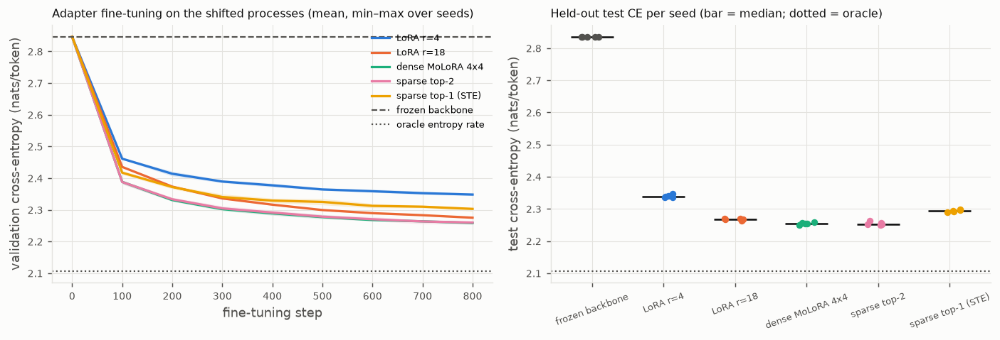

# Phase 4C — small Needle-native transformer with LoRA / MoLoRA adapters

Date: 2026-11-08. Branch `main`. CPU only.

## 1. Feasibility audit of the hw2 Needle framework (before any transformer code)

Inventory of `~/projects/dlsys/hw2/python/needle` relevant to a tiny
autoregressive transformer, checked by inspection and by a probe script that
built one attention block end to end and back-propagated through it:

| Component | hw2 Needle | Plan |
|---|---|---|
| Embedding layer | **absent** (`nn.Embedding` does not exist) | one-hot `(B, T, V)` constant tensor `@` a trainable `(V, d)` table; gradient to the table verified |
| Positional encoding | absent | learned `(T_max, d)` table via one-hot matmul, same mechanism |
| Layer normalisation | `nn.LayerNorm1d` (**2-D only**, normalises axis 1) | reshape `(B, T, d) -> (B*T, d)`, apply, reshape back (verified; gradient flows) |
| Multi-head self-attention | absent | `Linear` projections, `reshape` to `(B, T, H, d_h)`, `transpose(axes=(1, 2))`, 4-D batched `matmul` `q @ transpose(k, (2, 3))` (verified: Needle `MatMul` broadcasts leading dims and its gradient sums over them), scale by a **Python** float, additive causal mask |
| Causal masking | no masking op | add a constant `(B, H, T, T)` tensor with `-1e9` above the diagonal, then `molora.softmax` (logsumexp-based) over the last axis; probe shows exactly zero attention above the diagonal and rows summing to one |
| Softmax | `logsoftmax` is axis-1 only | `molora.router.softmax(z, axis=-1)` (Phase 2) |
| Residual connections | `nn.Residual(fn)` exists; plain `+` also works | plain `+` |
| Feed-forward network | `nn.Linear` (works on `(B, T, d)` inputs via batched matmul + bias broadcast) and `ReLU` | `Linear -> ReLU -> Linear`; GELU/tanh **absent**, ReLU used |
| Cross-entropy loss | `nn.SoftmaxLoss` (2-D logits, integer labels) | reshape logits to `(B*T, V)`, labels to `(B*T,)` (verified) |
| Dropout | `nn.Dropout` exists | `dropout = 0.0` in all experiments |
| Reshape / transpose | `reshape`, `transpose` (two axes, any rank) | sufficient |
| Sequence-compatible linear layers | `LoRALinear`, `DenseMoLoRALinear`, `SparseMoLoRALinear` already accept `(..., in)` inputs (Phases 1–3) | insert via `from_linear` |
| Optimizer | `optim.Adam` (explicit parameter list) | adapter-only parameter lists as in Phases 1–3 |
| dtype pitfall | dividing a float32 tensor by a **NumPy** float64 scalar promotes the graph to float64 (NEP 50 treats NumPy scalars as strong) | all scalars passed as Python `float`; a test asserts the model stays float32 |

Verdict: a 2-layer, `d_model = 64`, 4-head, `d_ff = 128`, `T = 32` decoder-only
transformer is implementable with existing Needle ops plus the Phase 2/3
`softmax`; nothing in the coursework needs to change. Costs: the one-hot
embedding is `O(B T V d)` instead of a gather (acceptable for `V ≤ 64`), and
attention materialises `(B, H, T, T)` scores (fine for `T = 32`). The
per-op Python overhead of Needle means CPU training is slow per step; model
and data sizes are chosen so a full fine-tuning run takes minutes.

## 2. Implementation (`models/`)

* `models/tiny_transformer.py`: `Embedding` (one-hot matmul), `LayerNorm`
  (reshape around `LayerNorm1d`), `CausalSelfAttention` (q/k/v/o `Linear`,
  heads via reshape + transpose, 4-D batched matmul, additive −1e9 mask,
  logsumexp softmax, Python-float scaling), `FeedForward` (Linear–ReLU–Linear),
  pre-LN `Block`, `TinyTransformer` (token + learned positional embeddings, `L`
  blocks, final LN, untied `lm_head`), `loss` via `SoftmaxLoss` on reshaped
  logits, `named_parameters` / `save_state` / `load_state` (npz).
* `models/transformer_adapters.py`: `freeze_backbone` (Phase 1 strategy),
  `inject_adapters(model, kind, ...)` replacing `ffn.fc1` / `ffn.fc2` (and
  optionally `attn.q_proj` / `attn.v_proj`) of every block with
  `LoRALinear` / `DenseMoLoRALinear` / `SparseMoLoRALinear` built by
  `from_linear` (frozen weights shared, not copied),
  `adapter_trainable_parameters` (duplicate-free, backbone excluded),
  `routing_stats`, `sparse_execution_stats`.
* Tests (`tests/test_tiny_transformer.py`, 8; `tests/test_transformer_adapters.py`,
  11): shapes and float32 dtype; exact causal masking at block and model
  level; LayerNorm vs NumPy; float64 finite differences on embedding,
  attention, FFN, LayerNorm and head parameters (rtol 1e-5); loss decrease and
  determinism; checkpoint round-trip; adapter injection preserves initial
  logits and shares storage for all three kinds; only adapter parameters
  trainable with the predicted counts; frozen backbone bit-identical after
  adapter training; dense = sparse `k = E` and reference = dispatch inside the
  transformer for logits and all adapter gradients (float64, rtol 1e-10);
  routing statistics and reproducible fine-tuning. All pass.

## 3. Controlled sequence task (`experiments/sequence_task.py`)

Four latent first-order Markov processes over a shared vocabulary of 16
tokens; each row of a transition matrix puts 85 % of its mass on 3 random
"hot" next tokens. A sequence (length 32 + 1) is generated by one process whose
identity is **never** given to the model. The pretraining distribution uses
processes `P_1..P_4`; the adaptation distribution uses process-specific shifts
`P'_k = 0.5 P_k + 0.5 Q_k` with fresh random `Q_k`, so the frozen backbone's
knowledge is wrong in a process-dependent way and adapters must learn a
correction that depends on the (inferred) process. Diagnostics computed from
the true matrices: entropy rate (oracle cross-entropy), oracle accuracy, and
Bayes identifiability of the process from a whole sequence.

| quantity (test split) | pretraining family | adaptation family |
|---|---|---|
| oracle cross-entropy (nats/token) | 1.737 | 2.107 |
| oracle next-token accuracy | 0.325 | 0.238 |
| unigram / chance CE | 2.773 | 2.773 |
| Bayes process identifiability from a sequence | — | 1.000 |

## 4. Shared frozen backbone

`python experiments/train_tiny_transformer.py pretrain` — 2 layers, d_model 64,
4 heads, d_ff 128, T = 32, 71 168 parameters, trained on 8 192 pooled
sequences for 1 500 Adam steps (lr 3e-3, batch 32, seed 0), checkpoint
`outputs/phase4c_transformer/backbone/backbone.npz` (reproducible from the
seed; outputs are git-ignored).

| | CE (nats/token) | accuracy |
|---|---|---|
| pretraining test (oracle 1.737 / 0.325) | 1.845 | 0.295 |
| **frozen backbone on the shifted adaptation test data** (oracle 2.107 / 0.238) | **2.835** | 0.167 |

The backbone learned non-trivial representations (within 0.11 nats of the
oracle on its own distribution) and is near chance on the shifted data, so the
adaptation task has real headroom (2.835 → 2.107).

## 5. Fine-tuning protocol (frozen before the confirmatory run)

Adapters in `ffn.fc1` and `ffn.fc2` of both blocks (4 layers), rank 4, α = 8,
`E = 4`, zero-`B` init, Xavier router; sparse layers in dispatch mode.
Methods: frozen; LoRA r=4 (3 072 trainable); parameter-matched LoRA r=18
(13 824); dense MoLoRA 4×r=4 (13 840 = adapters 12 288 + routers 1 552);
sparse top-2 (exact gradient); sparse top-1 (straight-through). 800 Adam steps,
batch 32, on 4 096 adaptation sequences; validation 512 / test 512 sequences.
Learning rate from a validation-only pilot on seed 4999 (1e-3 vs 3e-3; every
method chose 3e-3; the pilot log also printed test CE for that seed, which
was not used for selection and is a different seed from the study). Seeds
5000–5004 vary adapter initialisation and data order; the backbone checkpoint
is shared. Five seeds were chosen because a sparse fine-tuning run costs
≈ 2 min on this CPU (≈ 30 min for the study).

## 6. Adaptation results (`outputs/phase4c_transformer/study_20261108-180748`, 5 seeds)

Held-out test cross-entropy (nats/token) and accuracy; oracle entropy rate
2.107, frozen backbone 2.836.

| method | trainable params | test CE mean ± std | min–max | test acc | Δ CE vs dense [95 % paired bootstrap CI] | seeds better than dense | time / run (s) |
|---|---|---|---|---|---|---|---|
| frozen backbone | 0 | 2.8355 | — | 0.167 | +0.581 | — | 0 |
| LoRA r=4 | 3 072 | 2.3395 ± 0.0044 | 2.335–2.347 | 0.200 | +0.085 [+0.081, +0.089] | 0/5 | 22 |
| LoRA r=18 (matched) | 13 824 | 2.2679 ± 0.0028 | 2.263–2.270 | 0.206 | +0.0133 [+0.0120, +0.0150] | 0/5 | 23 |
| dense MoLoRA 4×r=4 | 13 840 | 2.2546 ± 0.0033 | 2.250–2.259 | 0.207 | — | — | 38 |
| sparse top-2 (dispatch) | 13 840 | 2.2549 ± 0.0055 | 2.251–2.264 | 0.208 | +0.0003 [−0.0024, +0.0029] | 2/5 | 134 |
| sparse top-1 (STE) | 13 840 | 2.2941 ± 0.0034 | 2.290–2.299 | 0.204 | +0.0395 [+0.0376, +0.0406] | 0/5 | 119 |

Every run kept all 71 168 backbone parameters bit-identical; sparse top-2
executed exactly 50 % of the dense adapter FLOPs (top-1: 25 %) in every layer.
Per-process test CE is uniform across the four processes for all methods
(dense 2.22–2.31, top-2 2.22–2.31). Router entropy per adapter layer
(uniform = 1.386): dense 0.54 / 0.42 / 0.40 / 0.32, top-2 0.55 / 0.38 / 0.43 /
0.26, top-1 0.45 / 0.30 / 0.34 / 0.31 — the routers are far from uniform,
i.e. they specialise on something, but with a latent process that must be
inferred from context the routing is not a clean one-expert-per-process
permutation as in Phases 2–4B (and need not be: the adapters sit in FFN
layers whose inputs are token representations, not sequences).



**Reading.** The adapters close ≈ 80 % of the gap between the frozen backbone
and the oracle ((2.836 − 2.255)/(2.836 − 2.107)). Dense MoLoRA and sparse
top-2 are statistically indistinguishable (Δ = +0.0003, CI spans zero) and
both beat the parameter-matched LoRA by 0.013 nats on every seed (CI excludes
zero) — a small but consistent benefit of routing over capacity in the
transformer, much smaller than in the synthetic regression tasks because
(i) FFN-level adapters in a 2-layer model have limited room and (ii) the
"regime" is a latent property of the whole sequence that a per-token router
only sees indirectly. Hard top-1 routing is clearly worse (+0.040). Five seeds:
the tie between dense and top-2 and the gap to the LoRA baselines are robust
across all five, but no claim beyond this task and scale is made.

## 7. Systems benchmark (`outputs/benchmark_transformer/20261108-183629`)

`python experiments/benchmark_transformer.py` — 1 BLAS thread, 3 warm-up + 20
timed repeats, medians. Inference = forward only; step = forward + backward +
Adam on the trainable parameters; peak = per-step peak Python/NumPy allocation
(tracemalloc). "Adapter share" = time inside the adapter layers' forward
divided by the whole forward; for sparse layers the layer profiler splits that
into router / expert / dispatch.

| B | T | method | trainable | forward ms | step ms | train tok/s | step peak MB | adapter share of forward | adapter fwd ms (router / expert / dispatch) |
|---|---|---|---|---|---|---|---|---|---|
| 8 | 16 | frozen | 0 | 2.47 | 2.60 | 49 255 | 0.37 | 0 % | 0 |
| 8 | 16 | LoRA r=4 | 3 072 | 3.92 | 8.64 | 14 806 | 7.8 | 19 % | 0.76 |
| 8 | 16 | dense E=4 | 13 840 | 4.01 | 13.65 | 9 375 | 15.1 | 43 % | 1.72 |
| 8 | 16 | sparse E=4 k=1 | 13 840 | 5.18 | 14.83 | 8 633 | 10.1 | 54 % | 2.86 (0.76 / 0.32 / 0.83) |
| 8 | 16 | sparse E=4 k=2 | 13 840 | 5.46 | 18.42 | 6 948 | 11.9 | 56 % | 3.03 (0.85 / 0.35 / 0.89) |
| 8 | 16 | sparse E=4 k=4 | 13 840 | 5.64 | 18.55 | 6 900 | 15.7 | 57 % | — |
| 8 | 32 | frozen | 0 | 3.45 | 3.59 | 71 302 | 0.86 | 0 % | 0 |
| 8 | 32 | LoRA r=4 | 3 072 | 3.64 | 15.70 | 16 302 | 14.9 | 17 % | 0.62 |
| 8 | 32 | dense E=4 | 13 840 | 5.53 | 22.06 | 11 604 | 28.7 | 42 % | 2.32 |
| 8 | 32 | sparse E=4 k=1 | 13 840 | 6.53 | 17.54 | 14 594 | 19.6 | 76 %* | 9.39 (4.00 / 0.35 / 0.86)* |
| 8 | 32 | sparse E=4 k=2 | 13 840 | 7.29 | 21.67 | 11 813 | 23.9 | 53 % | 3.73 (1.00 / 0.45 / 1.07) |
| 32 | 16 | dense E=4 | 13 840 | 15.41* | 25.85 | 19 806 | 58.1 | 51 % | 9.47* |
| 32 | 16 | sparse E=4 k=1 | 13 840 | 14.30 | 26.54 | 19 295 | 38.7 | 50 % | 4.48 (1.10 / 0.46 / 1.25) |
| 32 | 16 | sparse E=4 k=2 | 13 840 | 9.77 | 30.99 | 16 520 | 46.2 | 53 % | 5.28 (1.25 / 0.64 / 1.55) |
| 32 | 32 | frozen | 0 | 7.81 | 8.71 | 117 522 | 3.4 | 0 % | 0 |
| 32 | 32 | LoRA r=4 | 3 072 | 10.26 | 23.01 | 44 501 | 58.7 | 20 % | 1.96 |
| 32 | 32 | LoRA r=18 | 13 824 | 10.16 | 23.85 | 42 940 | 60.7 | 23 % | — |
| 32 | 32 | dense E=4 | 13 840 | 14.84 | 38.85 | 26 355 | 112.7 | 42 % | 5.53 |
| 32 | 32 | sparse E=4 k=1 | 13 840 | 15.20 | 39.91 | 25 656 | 77.3 | 45 % | 7.07 (1.60 / 0.71 / 1.96) |
| 32 | 32 | sparse E=4 k=2 | 13 840 | 17.48 | 50.33 | 20 344 | 93.9 | 50 % | 8.17 (1.82 / 1.03 / 2.39) |
| 32 | 32 | sparse E=4 k=4 | 13 840 | 19.25 | 65.56 | 15 619 | 122.3 | 55 % | — |
| 32 | 32 | dense E=8 | 27 680 | 19.85 | 55.70 | 18 385 | 174.5 | 57 % | 11.18 |
| 32 | 32 | sparse E=8 k=2 | 27 680 | 18.98 | 59.16 | 17 308 | 108.1 | 55 % | 10.14 (2.29 / 1.34 / 3.05) |

(* single-run medians that are visibly out of line with neighbouring
configurations — scheduling noise at the 1–10 ms scale with 20 repeats; rows
marked * are not used for conclusions. Full table with IQRs in `benchmark.md`.)

* **Is the adapter a large enough fraction of the transformer for sparsity to
  matter?** Yes in this model: MoE adapter layers take 42–57 % of the forward
  pass (LoRA: 17–23 %), because `d_model = 64` makes the backbone cheap. In a
  realistic transformer the backbone share is far larger and the adapter
  share correspondingly smaller.
* **Expert compute vs dispatch.** Inside the sparse adapter layers the expert
  matmuls are 0.3–1.3 ms while router + gather/scatter cost 1.6–4.3 ms; the
  dispatch alone exceeds the expert work it saves in every configuration.
  Sparse k=2's adapter time (3.0–8.2 ms) is 1.5–1.8× the dense adapter time
  (1.7–5.5 ms) despite doing half the expert FLOPs.
* **End-to-end wall clock.** Training step: sparse k=1 ≈ dense (0.80–1.09×),
  sparse k=2 0.98–1.35× dense, k=4 1.19–1.69× dense; inference forward:
  sparse k=1/k=2 1.0–1.4× dense. Train tokens/s: dense E=4 26 355 vs sparse
  k=2 20 344 at B=32, T=32. **No end-to-end speedup from sparse routing in this
  CPU transformer**; the Phase 3 single-layer break-even (≥ 512 tokens, k=1)
  does not carry over once the per-layer token count is 128–1024 spread over
  four adapter layers with their own fixed Python overhead.
* **Memory.** Per-step peak allocation: sparse k=1 uses 67–69 % and k=2
  79–83 % of dense (e.g. 77 / 94 vs 113 MB at B=32, T=32); with E=8, sparse
  k=2 uses 62 % of dense E=8 (108 vs 174 MB) at a 6 % higher step time. The
  memory saving scales with `E/k` and is the one systems benefit that
  survives in the transformer.
* **E=8.** Doubling experts doubles dense adapter cost (step 38.9 → 55.7 ms,
  peak 113 → 174 MB) while sparse k=2 grows less (50.3 → 59.2 ms, 94 → 108 MB).
* Process peak RSS over the whole benchmark: see `benchmark.json` (whole
  process, not per model). All numbers are CPU/NumPy; nothing is implied about
  GPUs.

## 8. Known limitations

Two-layer, `d_model = 64` model on a synthetic Markov task; adapters in FFN
layers only (q/v injection is implemented and tested but was not run); one
pretrained backbone; 5 seeds; 800 fine-tuning steps; per-op Python overhead of
Needle dominates all timings; the routing analysis inside the transformer is
limited to entropy / utilisation (no per-process routing matrix, since the
process is a sequence-level latent and adapters act per token); no real-text
corpus was evaluated.

## 9. Reproduction

```bash
python experiments/train_tiny_transformer.py pretrain      # ≈ 2 min
python experiments/train_tiny_transformer.py pilot         # ≈ 10 min
python experiments/train_tiny_transformer.py study         # ≈ 30 min (5 seeds x 6 methods)
python experiments/train_tiny_transformer.py analyze outputs/phase4c_transformer/study_<ts>
python experiments/benchmark_transformer.py                # ≈ 8 min
```
